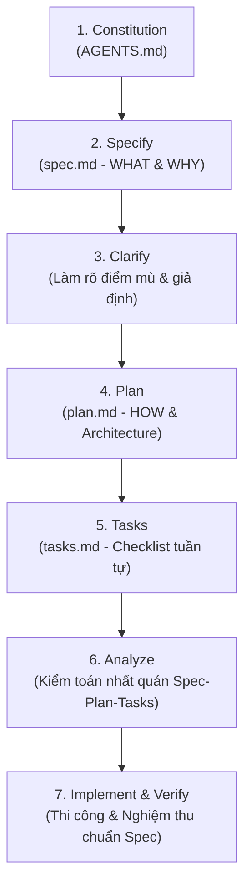

# 📐 Kỹ Năng Spec-Kit: Spec-Driven Development (SDD)

Kỹ năng này cung cấp phương pháp luận và quy trình **Phát triển Dựa trên Đặc tả (Spec-Driven Development - SDD)** theo chuẩn GitHub Spec-Kit (`github/spec-kit`) dành cho dự án `admin_orderlist`.

---

## 🎯 1. Triết Lý Cốt Lõi (Core Principles)

1. **Chống "Vibe-Coding" Tuyệt Đối**:
   - Nghiêm cấm việc nhảy vào viết code theo cảm tính, phỏng đoán yêu cầu hoặc chắp vá tạm bợ.
   - Mọi dòng code sinh ra đều phải có nguồn gốc từ một bản **Đặc Tả Kỹ Thuật (`spec.md`)** đã được phê duyệt.
2. **Đặc Tả Là Nguồn Sự Thật Duy Nhất (Single Source of Truth - SSOT)**:
   - Bản đặc tả không phải là tài liệu chết, mà là **hợp đồng sống (Living Contract)** giữa Master và đội ngũ Agent.
   - Khi có thay đổi yêu cầu, bản đặc tả phải được cập nhật trước, sau đó mới cập nhật mã nguồn.
3. **Phân Định "WHAT & WHY" vs "HOW"**:
   - `spec.md`: Bóc tách bài toán nghiệp vụ, hành vi người dùng, dữ liệu đầu vào/đầu ra, trường hợp biên (WHAT & WHY).
   - `plan.md`: Thiết kế giải pháp kỹ thuật, cơ sở dữ liệu, API contracts, tái sử dụng tài nguyên (HOW).

---

## 🔄 2. Quy Trình 7 Giai Đoạn Chuẩn Spec-Kit



### Chi Tiết Từng Giai Đoạn:

### Giai Đoạn 1: Constitution (`/constitution`)
- Nền tảng pháp lý tối cao đã được thiết lập tại `.agents/AGENTS.md`.
- Ràng buộc bất di bất dịch: Quyền tối cao của Master, ACID Transaction, Zero Error Swallowing, DRY, Bảo vệ mã nguồn Master.

### Giai Đoạn 2: Specify (`/specify` ➔ `spec.md`)
- Bóc tách User Stories:
  > **Là** [vai trò người dùng],  
  > **Tôi muốn** [hành động / tính năng],  
  > **Để** [giá trị nghiệp vụ đạt được].
- Khai báo **Tiêu chí Nghiệm thu (Acceptance Criteria)** theo định dạng **Gherkin**:
  ```gherkin
  Scenario: [Tên kịch bản nghiệp vụ]
    Given [Trạng thái ban đầu / Tiền điều kiện của hệ thống]
    When [Người dùng thao tác HOẶC Webhook/Cron/Sự kiện kích hoạt]
    Then [Kết quả mong đợi: Dữ liệu DB, phản hồi API, thông báo UI]
  ```
- Liệt kê các trường hợp biên (Edge Cases), giá trị tối đa/tối thiểu, rủi ro nhập sai dữ liệu.

### Giai Đoạn 3: Clarify (`/clarify`)
- Rà soát toàn diện để tìm các điểm mơ hồ, mâu thuẫn hoặc các giả định kỹ thuật ngầm.
- Nếu có điểm chưa rõ, đặt tối đa 2-3 câu hỏi then chốt có lựa chọn trắc nghiệm để Master quyết định dứt khoát.

### Giai Đoạn 4: Plan (`/plan` ➔ `plan.md`)
- Bóc tách kiến trúc kỹ thuật:
  - **Database**: Bảng mới hoặc cột bổ sung (luôn đối chiếu `dbSchema.js`, khóa ngoại, chỉ mục, ACID).
  - **Backend**: Routes, Controllers, Services, Event Bus, Cron Tasks.
  - **Frontend**: Pages, Components, Modals, State Management, Responsive Design.
- **Reuse Audit (Rà soát tái sử dụng - Bắt buộc)**:
  - Liệt kê chính xác các component có sẵn trong `shared/components/`.
  - Liệt kê các helper/service có sẵn trong `utils/`, `services/`.
- **Ranh Giới An Toàn (Redlines - CẤM LÀM GÌ)**:
  - Nêu đích danh các file, module, bảng dữ liệu KHÔNG ĐƯỢC PHÉP CHẠM VÀO.

### Giai Đoạn 5: Tasks (`/tasks` ➔ `tasks.md`)
- Phân rã kế hoạch thành danh sách nhiệm vụ tuần tự (Task 1 ➔ Task 2 ➔ Task 3...).
- Mỗi task phải:
  - Độc lập và có thể kiểm thử riêng biệt.
  - Chỉ rõ file bị tác động.
  - Có test case đi kèm (Unit test hoặc Integration test).
  - Có trạng thái trực quan: `[ ]` Chưa làm, `[/]` Đang làm dở, `[x]` Đã hoàn thành.

### Giai Đoạn 6: Analyze (`/analyze` - Kiểm Toán Nhất Quán 3 Chiều)
- Leader trực tiếp đối chiếu chéo:
  $$\text{spec.md} \iff \text{plan.md} \iff \text{tasks.md}$$
- Tiêu chí đạt chuẩn kiểm toán:
  - Mọi kịch bản Gherkin trong Spec đều có Task tương ứng để hiện thực hóa.
  - Không có Task nào phát sinh nằm ngoài phạm vi Spec (Scope Creep).
  - Kế hoạch tuân thủ 100% Constitution.

### Giai Đoạn 7: Implement & Verify (`/implement`)
- Xuất khung `[PRE-FLIGHT CHECK]` trình Master phê duyệt.
- Sau khi Master duyệt ("Đồng ý", "Thực hiện đi"):
  - Phân bổ tasks cho Backend Specialist, Frontend Lead, QA Automation.
  - Cập nhật checklist `tasks.md` sau mỗi bước hoàn thành.
  - Nghiệm thu cuối cùng (Acceptance Testing) đối chiếu 1-1 với kịch bản Gherkin trong `spec.md`.

---

## 📝 3. Mẫu Khung Đặc Tả Kỹ Thuật Chuẩn (Spec Template)

Khi khởi tạo một tính năng mới, Thư Ký xuất bản mẫu tài liệu sau:

```markdown
# 📋 ĐẶC TẢ TÍNH NĂNG (SPECIFICATION): [Tên tính năng]
**Phiên bản:** 1.0  
**Tác giả:** 📝 Lead Planner & Chronicler  
**Người duyệt:** 👑 Orchestrator Agent & Master  
**Trạng thái:** [Draft / Clarifying / Approved / Implemented]

## 1. Mục Tiêu & User Stories
- **Vấn đề cần giải quyết**: [Mô tả ngắn gọn]
- **User Story**: Là Master, tôi muốn... để...

## 2. Tiêu Chí Nghiệm Thu (Acceptance Criteria - Gherkin)
### Kịch bản 1: [Thành công cơ bản]
- **Given**: [Hệ thống đang ở trạng thái...]
- **When**: [Người dùng thực hiện hành động...]
- **Then**: [Kết quả mong đợi...]

### Kịch bản 2: [Trường hợp biên / Ngoại lệ / Lặp dữ liệu]
- **Given**: [...]
- **When**: [...]
- **Then**: [...]

## 3. Ràng Buộc Dữ Liệu & Ranh Giới (Constraints)
- Giới hạn giá trị, kiểu dữ liệu, tính duy nhất (Unique / Idempotency).
- Thời gian lưu trữ (Data Retention) nếu có.

## 4. Điểm Mù Cần Làm Rõ (Clarifications - nếu có)
- [ ] Câu hỏi 1: ...
- [ ] Câu hỏi 2: ...
```

