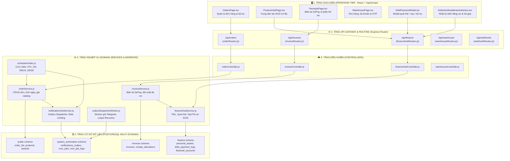

# 🗺️ BẢN ĐỒ ĐỒ THỊ TRI THỨC KIẾN TRÚC CODEBASE (CODEBASE KNOWLEDGE GRAPH)
**Hệ thống phân tích:** `codebase-memory-mcp` v0.12.1  
**Thời gian lập chỉ mục:** 2026-11-03 (Asia/Bangkok)  
**Tập tin cơ sở dữ liệu:** `.codebase-memory/graph.db.zst` (2.7 MB)  
**Mục tiêu:** Cung cấp bản đồ điều hướng liên kết file tức thì, chấm dứt việc phải đi tìm file thủ công giữa các tầng kiến trúc.

---

## 📊 1. Thống Kê Đồ Thị Tri Thức Toàn Dự Án

| Chỉ Số Đồ Thị | Số Lượng | Ý Nghĩa Kiến Trúc |
| :--- | :---: | :--- |
| **Tổng Số Nodes** | **5,404** | Tổng số thực thể code (Modules, Functions, Routes, Tables, Variables...) |
| **Tổng Số Edges (Liên Kết)** | **12,288** | Các mối quan hệ (Calls, Imports, Defines, Handles, Configures...) |
| **API Routes** | **230** | Điểm chạm giao tiếp HTTP giữa Frontend và Backend |
| **Hàm / Thủ Tục (Functions)** | **1,192** | Các hàm xử lý nghiệp vụ và tiện ích |
| **Bảng Cơ Sở Dữ Liệu (Tables)** | **135** | Các bảng và view dữ liệu thuộc PostgreSQL multi-schema |
| **Tập Tin Mã Nguồn (Files)** | **593** | Các file JavaScript, TypeScript, SQL, CSS... |
| **Mối Quan Hệ Gọi Hàm (CALLS)** | **1,615** | Mạng lưới gọi hàm nghiệp vụ xuyên suốt |
| **Mối Quan Hệ Nhập Module (IMPORTS)**| **529** | Cây phụ thuộc giữa các module nội bộ |

---

## 🏛️ 2. Sơ Đồ Kiến Trúc Đồ Thị Toàn Cảnh (Full Architecture Graph)



---

## 🔗 3. Ma Trận Truy Vết File Nhanh (Fast Linkage Reference Matrix)

### A. Phân Hệ Tài Chính, Nợ Cá Nhân & Quẹt Thẻ (Finance & Debts)
| Thành Phần | Đường Dẫn File | Vai Trò & Mối Liên Kết |
| :--- | :--- | :--- |
| **UI Trang Chính** | `frontend/src/features/finance/FinanceHubPage.tsx` | Hiển thị tổng quan tài sản, nợ, P&L |
| **UI Nhật Ký Nợ** | `frontend/src/features/finance/components/DebtsAndInstallmentsSection.tsx` | Bảng biến động nợ, đối chiếu thẻ 4 số cuối |
| **UI Modal Giao Dịch**| `frontend/src/features/finance/components/DebtPaymentModal.tsx` | Form Quẹt thẻ / Vay thêm / Trả nợ |
| **API Router** | `backend/src/domains/finance/routes/financeHubRoutes.js` | Định nghĩa route `/api/finance/...` |
| **Controller** | `backend/src/domains/finance/controllers/financeHubController.js` | Tiếp nhận request, kiểm tra auth & validate |
| **Domain Service** | `backend/src/domains/finance/services/financeHubService.js` | Chứa `borrowPersonalAsset` (Row Lock), `autoMatchCardTransaction` |
| **Bảng DB Nợ** | `finance.personal_assets` | Lưu số dư nợ, 4 số cuối thẻ, ngân hàng |
| **Bảng DB Nhật Ký** | `finance.debt_payment_logs` | Lưu lịch sử từng lần quẹt thẻ/trả nợ, reference_code |

---

### B. Phân Hệ Thông Báo Tự Động (Unified Notification Hub)
| Thành Phần | Đường Dẫn File | Vai Trò & Mối Liên Kết |
| :--- | :--- | :--- |
| **Outbox Hub Service** | `backend/src/domains/notifications/hub/notificationHubService.js` | Cổng nhận dispatch, chặn trùng `idempotency_key`, tự dọn dẹp 7 ngày |
| **Background Worker** | `backend/src/domains/notifications/hub/outboxDispatcherWorker.js` | Khóa `FOR UPDATE SKIP LOCKED`, giãn cách 1.5s, cứu hộ `recoverStaleProcessing` |
| **Dispatcher Nghiệp Vụ**| `backend/src/domains/notifications/telegram/dispatchers/orderNotifier.js` | Xây dựng thông điệp đơn hàng kèm VietQR |
| **Core Client** | `backend/src/domains/notifications/telegram/core/telegramClient.js` | Gọi Telegram API, xử lý retry rate limit 429 |
| **Bảng DB Outbox** | `system_automation.notifications_outbox` | Hàng đợi tin nhắn bền vững (Durable Outbox) |

---

### C. Phân Hệ Lập Lịch Tự Động (Cron Schedulers)
| Tác Vụ Cron | File Thực Thi | Lịch Trình & Nhiệm Vụ |
| :--- | :--- | :--- |
| **Nhắc Gia Hạn 4 Ngày** | `backend/src/scheduler/tasks/notifyFourDaysTask.js` | **07:00 Sáng**: Quét đúng đơn còn 4 ngày, gửi vào Outbox |
| **Báo Hết Hạn 0 Ngày** | `backend/src/scheduler/tasks/notifyZeroDaysTask.js` | **11:00 Sáng**: Quét đơn hết hạn trong ngày |
| **Sinh Lời Tiết Kiệm** | `backend/src/scheduler/tasks/creditSavingsProfitTask.js` | **00:15 Hàng giờ**: Lệch pha với đầu giờ, tính lãi kép |
| **Sao Lưu Database** | `backend/src/scheduler/tasks/autoBackupDatabaseTask.js` | **02:30 Sáng**: Kết xuất `pg_dump` an toàn |
| **Dọn Dẹp Log (7 Ngày)** | `backend/src/scheduler/tasks/finalizeDailySummaryTask.js` | **23:55 Đêm**: Chốt doanh thu ngày & dọn sạch log > 7 ngày |

---

## 🛠️ 4. Các Lệnh Tra Cứu Đồ Thị Nhanh (Fast Graph Commands)

```bash
# 1. Cập nhật lại chỉ mục toàn bộ Codebase (khi có nhiều thay đổi mới)
npm run graph:index

# 2. Xem tổng quan kiến trúc, số node, edge và routes
npm run graph:arch

# 3. Mở giao diện đồ thị trực quan tương tác (Interactive Visual Graph UI) trên trình duyệt
npx codebase-memory-mcp --ui=true --port=9749

# 4. Tra cứu vết gọi hàm (Caller / Callee) tức thì:
npx codebase-memory-mcp cli trace_path --project D-Desktop-admin-admin_orderlist --function-name borrowPersonalAsset

# 5. Tìm kiếm vị trí hàm / route bất kỳ:
npx codebase-memory-mcp cli search_graph --project D-Desktop-admin-admin_orderlist --name-pattern ".*Notification.*"
```

