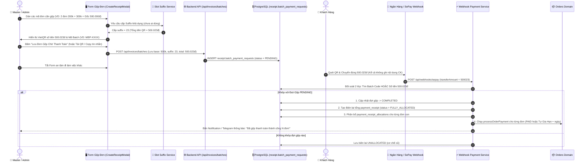

# KẾ HOẠCH & THIẾT KẾ KIẾN TRÚC: BẢNG LOG ĐƠN GỘP & TỰ ĐỘNG KHỚP THANH TOÁN / GIA HẠN KÈM SLOT SUFFIX

- **Ngày lập:** 29/10/2026  
- **Dự án:** `admin_orderlist` (Clean Architecture V2)  
- **Tác giả:** Đội ngũ Kỹ sư AI (Lead Planner & Chronicler)  
- **Người phê duyệt:** 👑 Master (Sếp)  
- **Vị trí tài liệu:** `docs/plans/2026-10-29_batch_payment_log_and_auto_reconciliation_plan.md`  

---

## 📌 1. BỐI CẢNH & NGUYÊN NHÂN GỐC (PROBLEM STATEMENT)

### 1.1. Hiện trạng
Tại trang Quản lý Biên Lai (`/receipts`), modal **"Tạo Đơn Thanh Toán Cho Khách Hàng"** (`CreateReceiptModal.tsx`) cho phép admin dán danh sách mã đơn (ví dụ: `MAVC01, MAVC02, MAVC03...`), tính tổng tiền và render động mã VietQR để gửi khách hàng.

### 1.2. Lỗ hổng nghiệp vụ phát hiện bởi Master
1. **Chưa lưu trạng thái phiên gộp:** Khi admin nhập các mã đơn và tạo QR, hệ thống chỉ vẽ mã QR trên giao diện client mà **chưa lưu bất kỳ bản ghi nào vào Database**.
2. **Mất liên kết khi đóng form:** Sau khi copy QR/tin nhắn gửi khách hàng, admin đóng modal. Khi khách hàng quét QR chuyển khoản qua SePay:
   - Webhook SePay nhận biến động số dư và tạo biên lai mới trong bảng `receipt.payment_receipt`.
   - Webhook tìm kiếm đơn hàng có `price` bằng đúng số tiền chuyển. Tuy nhiên, vì đây là **đơn gộp** (tổng tiền của 2-3 đơn cộng lại), không có đơn lẻ nào trùng giá trị này.
   - Hệ thống không thể tự nhận diện các đơn hàng cấu thành, dẫn đến biên lai bị đẩy vào trạng thái **`UNALLOCATED` (Chưa phân bổ)** tại tab *Chưa được liệt kê*.
   - Admin buộc phải vào làm thủ công thao tác phân bổ lại từng đơn hàng.
3. **Nguy cơ trùng lặp số tiền:** Nếu không có cơ chế **Slot Suffix (+1..100đ)** độc nhất cho đợt gộp, tổng tiền gộp có thể trùng với một đơn lẻ khác hoặc một đợt gộp khác, gây sai lệch đối soát khi khách không ghi đúng nội dung chuyển khoản.

---

## 🎯 2. NGUYÊN LÝ HOẠT ĐỘNG (MERMAID WORKFLOW)

---

## 🗄️ 3. THIẾT KẾ DATABASE SCHEMA (CHUẨN ACID & SSOT)

Bảng mới được tạo trong schema `receipt` theo quy hoạch Clean Architecture:

### Bảng: `receipt.batch_payment_requests`
| Cột | Kiểu dữ liệu | Ràng buộc | Ý nghĩa |
| :--- | :--- | :--- | :--- |
| `id` | `BIGSERIAL` | `PRIMARY KEY` | Khóa chính tự tăng |
| `batch_code` | `VARCHAR(50)` | `UNIQUE, NOT NULL` | Mã đợt gộp (VD: `MBP-20261029-A1B2`, in trên QR) |
| `order_codes` | `JSONB` | `NOT NULL` | Mảng mã đơn gộp (VD: `["MAVC881", "MAVC882"]`) |
| `order_ids` | `JSONB` | `NOT NULL` | Mảng ID đơn hàng tương ứng (VD: `[101, 102]`) |
| `base_amount` | `NUMERIC(15, 2)` | `NOT NULL` | **Tổng tiền gốc** của các đơn (VD: `500000.00`) |
| `slot_suffix` | `INT` | `NOT NULL, DEFAULT 0` | **Đuôi Slot Suffix** (1..100) (VD: `23`) |
| `total_amount` | `NUMERIC(15, 2)` | `NOT NULL` | **Số tiền chuyển thực tế** = `base_amount + slot_suffix` (`500023.00`) |
| `financial_account_id` | `BIGINT` | `REFERENCES partner.shop_bank_accounts(id)` | Tài khoản ngân hàng nhận tiền |
| `customer_name` | `VARCHAR(255)` | `NULLABLE` | Tên khách hàng (nếu các đơn cùng 1 khách) |
| `status` | `VARCHAR(30)` | `DEFAULT 'PENDING'` | `PENDING` (Chờ TT), `COMPLETED` (Đã TT), `EXPIRED` (Hết hạn), `CANCELED` (Đã hủy) |
| `payment_receipt_id` | `BIGINT` | `REFERENCES receipt.payment_receipt(id)` | ID biên lai phát sinh sau khi khách thanh toán thành công |
| `note` | `TEXT` | `NULLABLE` | Ghi chú đợt gộp |
| `created_by` | `VARCHAR(100)` | `DEFAULT 'ADMIN'` | Người tạo phiên gộp |
| `expires_at` | `TIMESTAMPTZ` | `NOT NULL` | Thời gian hết hạn đợt gộp (Mặc định: 72 giờ từ lúc tạo) |
| `created_at` | `TIMESTAMPTZ` | `DEFAULT CURRENT_TIMESTAMP` | Thời điểm tạo |
| `updated_at` | `TIMESTAMPTZ` | `DEFAULT CURRENT_TIMESTAMP` | Thời điểm cập nhật |

#### Chỉ mục (Indexes):
* `idx_batch_payment_code` ON (`batch_code`)
* `idx_batch_payment_status` ON (`status`)
* `idx_batch_payment_matching` ON (`total_amount`, `financial_account_id`, `status`)

---

## 🔢 4. THUẬT TOÁN QUẢN LÝ SLOT SUFFIX TOÀN HỆ THỐNG

Để đảm bảo số đuôi (+1..100) của đợt gộp không bao giờ trùng với bất kỳ đơn lẻ hay đợt gộp nào khác:

### Cập nhật hàm `getAvailableSuffix()` trong `slotSuffixService.js`:
1. Quét toàn bộ `price % 100` của các đơn lẻ đang có trạng thái `UNPAID` hoặc `RENEW_REQUIRED`.
2. Quét toàn bộ `slot_suffix` của các đợt gộp trong `receipt.batch_payment_requests` có `status = 'PENDING'` và `expires_at >= NOW()`.
3. Tập hợp vào `usedSuffixes: Set<number>`.
4. Tìm số nhỏ nhất từ `1` đến `100` chưa nằm trong `usedSuffixes` để cấp phát.

---

## ⚡ 5. CƠ CHẾ ĐỐI SOÁT 2 LỚP TRONG WEBHOOK SEPAY

Khi SePay bắn Webhook số tiền về (ví dụ `500.023đ`), hàm `processPaymentWebhook` tại `webhookPaymentService.js` thực hiện đối soát theo 2 lớp:

### Lớp 1: Khớp theo Mã Batch (`batch_code`)
- Trích xuất nội dung chuyển khoản xem có chứa tiền tố `MBP-[A-Z0-9]+` hay không.
- Nếu có, tìm trực tiếp đợt gộp có `batch_code` tương ứng.

### Lớp 2: Khớp theo Số Tiền Độc Nhất (`total_amount = 500.023đ`)
- Nếu khách xóa nội dung chuyển khoản hoặc ngân hàng làm mất nội dung:
  - Tìm bản ghi `batch_payment_requests` có `total_amount = transferAmount`, `financial_account_id = tài khoản nhận`, `status = 'PENDING'`, `expires_at >= NOW()`.
  - Nhờ có Slot Suffix (1..100) độc nhất, số tiền `500.023đ` đảm bảo duy nhất 100% trong toàn hệ thống.

### Xử lý giao dịch ACID khi khớp thành công:
1. Đổi trạng thái đợt gộp: `status = 'COMPLETED'`.
2. Tạo 1 Biên lai tổng `payment_receipt` với `amount = 500023`, `status = 'FULLY_ALLOCATED'`.
3. Phân bổ chi tiết cho từng đơn con:
   - Các đơn con đầu tiên được phân bổ đúng tiền gốc của đơn.
   - Đơn con cuối cùng nhận tiền gốc + khoản bù slot suffix (23đ), đảm bảo tổng phân bổ khớp chính xác `500.023đ`.
4. Tự động xử lý trạng thái từng đơn hàng:
   - **Đơn "Cần Gia Hạn" (`RENEW_REQUIRED`):** Gọi `calculateNewExpiry`, tự động cộng thêm chu kỳ ngày sử dụng và chuyển sang `PAID`.
   - **Đơn "Chưa Thanh Toán" (`UNPAID` / `PROCESSING`):** Chuyển sang `PAID` và ghi nhận doanh thu.
5. Gửi thông báo tự động qua Telegram & Notification Context.

---

## 🖥️ 6. THIẾT KẾ GIAO DIỆN FRONTEND

### 6.1. Modal `CreateReceiptModal.tsx`
- Tự động gọi API lấy `slot_suffix` khi danh sách đơn hàng thay đổi.
- Hiển thị bảng tóm tắt:
  - Tiền gốc đơn gộp: `500.000 ₫`
  - Đuôi Slot Suffix: `+ 23 ₫`
  - **Tổng tiền thanh toán VietQR: `500.023 ₫`**
- Nút **`"💾 Lưu Đơn Gộp Chờ Thanh Toán"`**
- Tính năng tự động lưu thông minh: Khi admin bấm **"Tải Ảnh QR"** hoặc **"Copy Tin Nhắn Gửi Khách"**, hệ thống tự động gọi API lưu đợt gộp vào database ngầm để admin yên tâm đóng modal.

### 6.2. Trang Quản Lý Biên Lai `ReceiptsPage.tsx`
- Bổ sung bảng theo dõi: **"Đợt Gộp Đang Chờ (Pending Batches)"**.
- Hiển thị danh sách các đợt gộp đang chờ khách chuyển tiền, kèm nút **"Hủy đợt gộp"** để giải phóng slot suffix nếu khách đổi ý không mua nữa.

---

## 📋 7. KẾ HOẠCH TRIỂN KHAI THEO CÁC BƯỚC (CHECKLIST)

- [x] **Bước 1:** Viết file Migration `20261029000001_create_batch_payment_requests.js` và cập nhật `backend/src/db/tables.js`.
- [x] **Bước 2:** Cập nhật `slotSuffixService.js` mở rộng quét suffix cho cả đợt gộp.
- [x] **Bước 3:** Viết service `batchPaymentService.js` và đăng ký API routes tại `backend/src/domains/invoices/routes.js`.
- [x] **Bước 4:** Tích hợp logic đối soát đợt gộp 2 lớp vào `webhookPaymentService.js`.
- [x] **Bước 5:** Cập nhật giao diện `CreateReceiptModal.tsx` và `ReceiptsPage.tsx`.
- [x] **Bước 6:** Viết integration test `batch_payment_webhook_reconciliation.test.js` kiểm tra kịch bản giả lập webhook thanh toán và gia hạn thành công 100%.
- [x] **Bước 7:** Build TypeScript Frontend và nghiệm thu toàn diện cùng Master.

