# CHIẾN LƯỢC MỞ RỘNG KIẾN TRÚC & TỐI ƯU TỐC ĐỘ DỮ LIỆU
## QUY MÔ: 10.000.000 ĐƠN HÀNG & 1.000.000 SẢN PHẨM

> **Tài liệu chiến lược:** `STRAT-2026-10-31-SCALE`  
> **Tác giả:** Lead Planner & Master Orchestrator  
> **Trạng thái:** 🎯 BẢN QUY HOẠCH CHIẾN LƯỢC TOÀN DIỆN (SYSTEM ARCHITECTURE BLUEPRINT)

---

## 🛑 1. BẢN ĐỒ HIỆN TRẠNG & 4 "ĐIỂM CHẾT" (CRITICAL BREAKING POINTS)

Nếu giữ nguyên kiến trúc và luồng xử lý như hiện tại, khi hệ thống tăng trưởng chạm mốc **10 triệu đơn hàng** và **1 triệu sản phẩm**, hệ thống sẽ lập tức đối mặt với **4 điểm sụp đổ chí tử**:

```mermaid
flowchart TD
    subgraph Client ["🖥️ CLIENT (TRÌNH DUYỆT)"]
        A["Fetch /prices?limit=1000"] -->|Nếu đổi thành 1M sản phẩm| B["🛑 ĐIỂM CHẾT 1: Browser Out-Of-Memory (OOM)<br>Payload 300MB-500MB -> Trình duyệt treo cứng!"]
        C["Render Dropdown/Table 1M dòng"] --> B
    end

    subgraph Backend ["⚙️ BACKEND (NODE.JS / EXPRESS)"]
        D["Lật trang /api/orders?page=50000"] -->|OFFSET 1,000,000| E["🛑 ĐIỂM CHẾT 2: Deep Offset Trap<br>Quét bỏ qua hàng triệu dòng -> Tắc nghẽn CPU"]
        F["Mở OrdersPage -> Đếm 4 tabCounts"] -->|COUNT(*) trên 10M rows| G["🛑 ĐIỂM CHẾT 3: Postgres Sequential Scan<br>Mất 5s - 15s cho mỗi request đếm tab!"]
        H["Tìm kiếm ILIKE '%keyword%'"] -->|Full Table Scan 10M rows| I["🛑 ĐIỂM CHẾT 4: CPU 100% & Pool Exhaustion<br>Sập toàn bộ kết nối DB (504 Gateway Timeout)"]
    end

    B -.-> Sập Hệ Thống
    E -.-> Sập Hệ Thống
    G -.-> Sập Hệ Thống
    I -.-> Sập Hệ Thống
```

---

### Điểm chết 1: Trình duyệt sập vì OOM (Out Of Memory) với 1.000.000 sản phẩm
- **Hiện trạng code:** [`useOrderCatalog.ts`](file:///e:/Project/admin_store/admin_orderlist/frontend/src/features/orders/hooks/useOrderCatalog.ts) đang gọi:
  ```javascript
  fetch("/api/products/prices?limit=1000")
  ```
- **Hậu quả khi đạt 1M sản phẩm:** 
  - Nếu cố fetch toàn bộ bảng giá của 1 triệu sản phẩm về client: Một file JSON nặng từ **300 MB – 500 MB** sẽ được đẩy xuống client.
  - V8 Engine của Chrome chỉ có hạn mức bộ nhớ giới hạn cho mỗi tab. Trình duyệt sẽ lập tức đứng hình (UI Freeze) và ném lỗi `Error code: Out of Memory` (Tab Crash).
  - Không thể render 1 triệu thẻ `<option>` trong component Select HTML thông thường.

---

### Điểm chết 2: Sập Database vì `COUNT(*)` Runtime trên 10.000.000 đơn hàng
- **Hiện trạng code:** [`orderService.js`](file:///e:/Project/admin_store/admin_orderlist/backend/src/domains/orders/services/orderService.js) đang tính tabCounts khi vào trang:
  ```javascript
  const [[canceledRes], [expiredRes], [importRes], [activeRes]] = await Promise.all([
    getOrderTable().where(applyCanceledFilter).count("id as count"),
    getOrderTable().where(applyExpiredFilter).count("id as count"),
    getOrderTable().where(applyImportFilter).count("id as count"),
    getOrderTable().where(applyActiveFilter).count("id as count"),
  ]);
  ```
- **Hậu quả khi đạt 10M đơn hàng:**
  - Trong PostgreSQL, `COUNT(*)` không lưu sẵn metadata mà phải duyệt qua tất cả visibility map / tuples để kiểm tra tính hợp lệ của transaction (MVCC).
  - 4 câu query `COUNT(*)` trên bảng 10 triệu dòng sẽ mất từ **3 đến 10 giây**.
  - Chỉ cần 10 admin mở trang cùng một lúc ➔ Connection Pool của PostgreSQL cạn kiệt ➔ Server treo đơ, toàn bộ API khác tê liệt!

---

### Điểm chết 3: "Cạm bẫy" Deep Offset Pagination (`LIMIT ... OFFSET ...`)
- **Hiện trạng code:** [`orderService.js`](file:///e:/Project/admin_store/admin_orderlist/backend/src/domains/orders/services/orderService.js) dùng:
  ```javascript
  const offset = (page - 1) * limit;
  // query.limit(limit).offset(offset);
  ```
- **Hậu quả:** 
  - Khi người dùng ở trang 1: `OFFSET 0 LIMIT 15` chạy rất nhanh (2ms).
  - Nhưng khi tìm kiếm hoặc lật sâu (ví dụ trang 10.000: `OFFSET 150000 LIMIT 15`), PostgreSQL buộc phải **đọc qua 150.000 bản ghi** rồi vứt bỏ, chỉ lấy 15 bản ghi cuối. Độ trễ tăng theo hàm tuyến tính $O(N)$, trang sẽ mất vài giây chỉ để lật trang.

---

### Điểm chết 4: Tìm kiếm chuỗi Full-Text bằng `ILIKE '%keyword%'`
- **Hiện trạng code:** [`orderService.js`](file:///e:/Project/admin_store/admin_orderlist/backend/src/domains/orders/services/orderService.js):
  ```javascript
  builder
    .whereILike(O_COLS.ID_ORDER, `%${trimmedSearch}%`)
    .orWhereILike(O_COLS.CUSTOMER, `%${trimmedSearch}%`)
    .orWhereILike(O_COLS.CONTACT, `%${trimmedSearch}%`)
  ```
- **Hậu quả:**
  - B-Tree Index tiêu chuẩn trong database **hoàn toàn vô dụng** với mẫu tìm kiếm chứa dấu `%` ở đầu (`%abc%`).
  - PostgreSQL bắt buộc phải thực hiện **Full Table Scan** duyệt qua toàn bộ 10 triệu dòng đĩa cứng để so khớp chuỗi. Mỗi lượt tìm kiếm sẽ ngốn 100% CPU của máy chủ.

---

## 🚀 2. CHIẾN LƯỢC QUY HOẠCH 5 TRỤ CỘT ĐỘT PHÁ (THE 5-PILLAR ARCHITECTURE)

Để hệ thống xử lý **10 triệu đơn hàng** và **1 triệu sản phẩm** mượt mà với thời gian tải trang **< 200ms**, chúng ta sẽ áp dụng kiến trúc 5 trụ cột tiêu chuẩn công nghiệp:

```mermaid
graph TB
    subgraph P1 ["TRỤ CỘT 1: PHÂN VÙNG DỮ LIỆU (DATABASE PARTITIONING)"]
        O[10 Triệu Đơn Hàng] -->|Range Partition theo Tháng| P_Cur["Hot Partition: Tháng Hiện Tại (200k đơn)"]
        O --> P_Prev["Warm Partition: 3-6 Tháng Trước (1M đơn)"]
        O --> P_Old["Cold Partition: Đơn > 1 Năm (Read-Only)"]
    end

    subgraph P2 ["TRỤ CỘT 2: PRE-COMPUTED COUNTERS & EVENT-DRIVEN"]
        E[Tạo Đơn / Đổi Trạng Thái] -->|Domain Event| Counter["Bảng Thống Kê Tức Thời: system_counters<br>(Redis hoặc Atomic DB Table)"]
        UI_Tab[Lấy TabCounts & Thống Kê] -->|O 1 Seek: 0.2ms| Counter
    end

    subgraph P3 ["TRỤ CỘT 3: KEYSET PAGINATION (CURSOR-BASED)"]
        NextPage["Lật Trang Tiếp Theo"] -->|WHERE id < last_seen_id ORDER BY id DESC LIMIT 15| Keyset["Index Seek O 1: Luôn < 5ms dù ở trang nào!"]
    end

    subgraph P4 ["TRỤ CỘT 4: SEARCH ENGINE & GIN TRIGRAM"]
        Search["Tìm Kiếm: 1M SP & 10M Đơn"] --> SearchEngine["PostgreSQL pg_trgm (GIN Index) hoặc Meilisearch<br>Trả kết quả mờ tiếng Việt trong 15ms"]
    end

    subgraph P5 ["TRỤ CỘT 5: FRONTEND SERVER-SIDE AUTOCOMPLETE"]
        ModalCreate["Modal Tạo Đơn Hàng"] -->|Debounce 300ms gõ tới đâu tìm tới đó| AutoComplete["Server trả Top 20 sản phẩm khớp nhất<br>Client chỉ nạp vài KB thay vì 300MB!"]
    end
```



---

### TRỤ CỘT 1: Phân Vùng Bảng (PostgreSQL Table Partitioning) & Dữ Liệu Nóng/Lạnh
1. **Partitioning theo Thời gian (Range Partitioning theo Tháng):**
   - Bảng `business.order_list` được cấu trúc thành các partition theo tháng: `order_list_y2026m10`, `order_list_y2026m11`...
   - **Quy luật 90/10:** 90% thao tác hàng ngày của Admin chỉ xử lý đơn trong tháng hoặc đơn đang hoạt động (Active/Renew).
   - Khi truy vấn `WHERE order_date >= '2026-10-01'`, PostgreSQL tự động kích hoạt **Partition Pruning**: Nó chỉ đọc đúng partition của tháng 10 (~200.000 dòng), hoàn toàn bỏ qua 9.800.000 dòng còn lại!
   - Tốc độ đọc tăng vọt **gấp 50 lần**.
2. **Cold Data Archiving (Lưu trữ Dữ liệu Lạnh):**
   - Đơn hàng đã hoàn thành hoặc hủy trên 1-2 năm được di chuyển vào partition lưu trữ lịch sử hoặc nén dạng `pg_dump / columnar storage`, giải phóng dung lượng đĩa và buffer cache RAM cho DB chính.

---

### TRỤ CỘT 2: Triệt Tiêu `COUNT(*)` Runtime Bằng Pre-computed Counters & Redis
1. **Tuyệt đối cấm chạy `COUNT(*)` trên 10 triệu dòng:**
   - Thay vào đó, tạo một bảng siêu nhẹ `business.system_counters` hoặc Redis Key:
     ```sql
     CREATE TABLE business.system_counters (
         metric_key VARCHAR(50) PRIMARY KEY,
         total_count BIGINT DEFAULT 0,
         updated_at TIMESTAMP WITH TIME ZONE DEFAULT NOW()
     );
     ```
2. **Cơ chế cập nhật nguyên tử ($O(1)$ Atomic Increment):**
   - Khi một đơn hàng mới được tạo ➔ `UPDATE system_counters SET total_count = total_count + 1 WHERE metric_key = 'orders_active'`.
   - Khi chuyển trạng thái từ ACTIVE ➔ EXPIRED ➔ Giảm `orders_active` đi 1, tăng `orders_expired` lên 1 trong cùng transaction.
   - Khi nạp trang Đơn hàng: Lấy số lượng 4 tabs chỉ mất **0.1ms** ($O(1)$) thay vì quét 10 triệu records!

---

### TRỤ CỘT 3: Chuyển Sang Keyset Pagination (Cursor-Based Pagination)
1. **Loại bỏ `OFFSET` truyền thống:**
   - Thay vì:
     ```sql
     SELECT * FROM order_list ORDER BY id DESC LIMIT 15 OFFSET 150000; -- Rất chậm!
     ```
   - Chuyển sang Keyset Pagination dựa trên Index cột `id` (hoặc `created_at, id`):
     ```sql
     SELECT * FROM order_list 
     WHERE id < 9854200 
     ORDER BY id DESC 
     LIMIT 15; -- Chạy bằng Index Seek, tốc độ luôn < 3ms ở bất kỳ trang nào!
     ```
2. **Trải nghiệm trên UI:**
   - Hỗ trợ nút "Trang tiếp / Trang trước" hoặc Infinite Scroll (Cuộn vô tận) với độ mượt tuyệt đối.

---

### TRỤ CỘT 4: Hạ Tầng Tìm Kiếm — PostgreSQL GIN Trigram hoặc Meilisearch
1. **Tìm kiếm tức thời trên 10M đơn hàng & 1M sản phẩm:**
   - Cài đặt extension `pg_trgm` trên PostgreSQL:
     ```sql
     CREATE EXTENSION IF NOT EXISTS pg_trgm;
     CREATE INDEX idx_order_customer_trgm ON business.order_list USING gin (customer gin_trgm_ops);
     CREATE INDEX idx_order_id_order_trgm ON business.order_list USING gin (id_order gin_trgm_ops);
     CREATE INDEX idx_product_name_trgm ON business.product USING gin (name gin_trgm_ops);
     ```
   - Với GIN Index Trigram, câu lệnh `whereILike('%keyword%')` sẽ chạy trực tiếp qua Index cây nhị phân, giảm thời gian tìm kiếm từ **8 giây xuống còn 20ms - 40ms**!
2. **Nâng cấp cao hơn (Nếu cần Full-Text Search chuyên biệt):**
   - Đưa **Meilisearch** vào làm search-engine phụ trợ (sidecar). Đồng bộ dữ liệu qua Change Data Capture (CDC). Meilisearch hỗ trợ tìm kiếm tiếng Việt không dấu, gõ sai chính tả (typo tolerance) với tốc độ **< 15ms** trên 1 triệu sản phẩm.

---

### TRỤ CỘT 5: Frontend Server-Side Autocomplete & DOM Virtualization
1. **Quy tắc bất biến cho 1.000.000 sản phẩm:**
   - **KHÔNG BAO GIỜ tải toàn bộ danh mục sản phẩm về trình duyệt.**
   - Thay thế toàn bộ select-box tĩnh trong Modal Tạo Đơn / Sửa Đơn bằng **Async Combobox (Debounced Autocomplete)**:
     - Khi mở modal: Không fetch gì cả (0 KB).
     - Khi Master bắt đầu gõ "Google..." (sau 300ms dừng gõ): Frontend gửi request `GET /api/products/search?q=Google&limit=20`.
     - Backend dùng GIN index trả về đúng 20 sản phẩm phù hợp nhất trong 15ms. Payload trả về chỉ **2 KB** thay vì 300 MB!
2. **DOM Virtualization (Ảo hoá DOM):**
   - Sử dụng thư viện `@tanstack/react-virtual` nếu cần hiển thị danh sách dài hàng ngàn mục. Trình duyệt chỉ render 20 phần tử đang nhìn thấy trên màn hình, giải phóng 98% bộ nhớ RAM của máy tính.

---

## 📊 BẢNG SO SÁNH HIỆU NĂNG TỔNG THỂ

| Tiêu chí kỹ thuật | Kiến trúc Hiện Tại (10M Đơn / 1M SP) | Kiến trúc Sau Quy Hoạch (5 Trụ Cột) |
| :--- | :--- | :--- |
| **Dung lượng Payload nạp sản phẩm** | 💥 **300 MB – 500 MB** (Sập tab Chrome) | ⚡ **2 KB – 5 KB** (Chỉ nạp kết quả tìm) |
| **Thời gian tính 4 Tabs Count** | 💥 **5s – 15s** (Quét 10 triệu dòng) | ⚡ **< 0.5ms** (Truy vấn bảng Counter $O(1)$) |
| **Thời gian lật trang (Trang 1000+)** | 💥 **3s – 8s** (Deep Offset Penalty) | ⚡ **< 5ms** (Keyset Pagination $O(1)$ Seek) |
| **Thời gian Tìm kiếm từ khoá** | 💥 **5s – 12s** (Full Table Scan 100% CPU) | ⚡ **15ms – 30ms** (GIN Trigram Index / Meilisearch) |
| **Bộ nhớ RAM Server tiêu thụ** | 💥 Tràn RAM do buffer scan hàng triệu row | 🟢 Ổn định, chỉ cache Hot Partitions |
| **Trải nghiệm người dùng (UX)** | 💥 Đơ chuột, chờ đợi, lỗi Timeout | 🌟 Mượt mà, phản hồi ngay lập tức (< 100ms) |

---

## 🗺️ LỘ TRÌNH CHUYỂN ĐỔI THEO TỪNG MỐC TĂNG TRƯỞNG (SCALING ROADMAP)

```
[Hiện tại: 10k - 50k đơn]
   │
   ├──> Giai đoạn 1: Áp dụng ngay Plan PERF-2026-10-31 (Gzip, On-demand Lazy fetch, Client SWR, Parallel SQL)
   │
[Mốc 1: Đạt 200k - 500k đơn / 50k sản phẩm]
   │
   ├──> Giai đoạn 2: Cài đặt GIN Trigram Index (pg_trgm) cho cột tìm kiếm
   ├──> Chuyển đổi dropdown sản phẩm sang Server-side Autocomplete Combobox
   ├──> Xây dựng bảng Counter Table (loại bỏ COUNT(*) trên order_list)
   │
[Mốc 2: Đạt 1 Triệu - 5 Triệu đơn / 200k sản phẩm]
   │
   ├──> Giai đoạn 3: Phân vùng bảng Database (PostgreSQL Monthly Partitioning)
   ├──> Chuyển đổi hoàn toàn sang Keyset Pagination (Cursor-based)
   ├──> Thiết lập Redis Caching cho metadata và counters
   │
[Mốc 3: Đạt 10 Triệu đơn / 1 Triệu sản phẩm]
   │
   └──> Giai đoạn 4: Tách Read/Write Replica (CQRS pattern)
        Triển khai Meilisearch chuyên dụng cho tìm kiếm sản phẩm và đơn hàng
        Lưu trữ dữ liệu lạnh (Cold Data Archiving)
```

