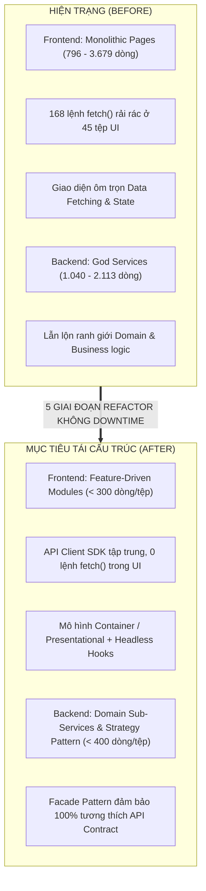
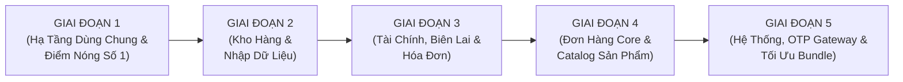

# 🏛️ KẾ HOẠCH TỔNG THỂ TÁI CẤU TRÚC TOÀN BỘ CODEBASE (MASTER REFACTORING PLAN)
# CHUYỂN ĐỔI TOÀN DIỆN SANG KIẾN TRÚC MODULAR THEO MIỀN (FEATURE-DRIVEN & SUB-SERVICES)

> **Dự án:** `admin_orderlist`  
> **Chủ nhân tối cao (Sovereign):** 👑 Master (Sếp)  
> **Tổng chỉ huy kỹ thuật:** 👑 Orchestrator Agent  
> **Quy mô hệ thống:** 311 tệp tin mã nguồn, **78.611 dòng code** (Frontend: 47.971 lines | Backend: 30.640 lines)  
> **Thời điểm ban hành:** 08/11/2026 (`Asia/Bangkok`)  
> **Tài liệu nguồn sự thật (SSOT):** [`docs/plans/2026-11-08_comprehensive_codebase_refactor_master_plan.md`](file:///e:/Project/admin_store/admin_orderlist/docs/plans/2026-11-08_comprehensive_codebase_refactor_master_plan.md)  
> **Trạng thái:** Kế hoạch tổng thể toàn dự án — Đã sẵn sàng thực thi  

---

## 🎯 1. TẦM NHÌN, MỤC TIÊU & CHỈ SỐ ĐỊNH LƯỢNG (TARGET METRICS)

Kế hoạch này sinh ra nhằm xóa bỏ triệt để vấn đề: *"Mỗi lần phát triển một cấu hình hay tính năng mới, code lại bị dồn toàn bộ vào một file duy nhất"*. Hệ thống sẽ được chuyển đổi sang chuẩn kiến trúc công nghiệp cao cấp (Clean Architecture & Feature-Driven Modules):



### 📊 Bảng So Sánh Chỉ Số Định Lượng Hệ Thống
| Tiêu Chí Đo Lường | Hiện Trạng (Before) | Mục Tiêu Sau Refactor (After) | Đánh Giá Cải Thiện |
|---|---|---|---|
| **Kích thước file Frontend lớn nhất** | 3.679 dòng ([`ExternalApiConfigPage.tsx`](file:///e:/Project/admin_store/admin_orderlist/frontend/src/pages/ExternalApiConfigPage.tsx)) | **< 250 dòng** / mỗi tệp | Giảm **93%** độ cồng kềnh |
| **Kích thước file Backend lớn nhất** | 2.113 dòng ([`orderService.js`](file:///e:/Project/admin_store/admin_orderlist/backend/src/domains/orders/services/orderService.js)) | **< 400 dòng** / mỗi sub-service | Giảm **81%** độ phức tạp |
| **Lệnh `fetch()` trực tiếp trong UI** | 168 lệnh rải rác tại 45 file | **0 lệnh**, 100% qua API Client | Triệt tiêu 100% rác mạng |
| **Số lượng God Services (> 1.000 dòng)** | 5 dịch vụ | **0 dịch vụ** | Cô lập lỗi, test độc lập |
| **Trang đa Tab** | Viết dồn chung 1 file, tải đồng thời | **Code-splitting tải theo tab** | Giảm 60% bundle ban đầu |
| **Độ rủi ro khi sửa tính năng** | Sửa 1 tab dễ làm hỏng toàn trang | **Cách ly tuyệt đối theo domain** | Zero Side-effect |

---

## 🛡️ 2. HIẾN PHÁP AN TOÀN TUYỆT ĐỐI (ZERO-REGRESSION PROTOCOL)

Bất kỳ thay đổi nào trong suốt 5 giai đoạn đều phải tuân thủ nghiêm ngặt 5 chốt chặn an toàn:

1. **Bóc Tách Nguyên Bản (Pure Structural Extraction):**
   - Chỉ di dời và đóng gói lại cấu trúc thư mục, tệp tin và module.
   - Giữ nguyên vẹn 100% logic thuật toán, tên biến state, payload API, URL endpoint và class styling Tailwind CSS.
2. **Khóa Tương Thích Backend (Facade Pattern & Strict Contract Compatibility):**
   - Các file service gốc (như `orderService.js`, `financeHubService.js`) được giữ lại làm **Facade điều phối**. Các controller và route bên ngoài không cần sửa đổi dù chỉ 1 dòng code gọi hàm.
   - API contract (Input/Output JSON, Status Codes) giữ nguyên 100%.
3. **An Toàn Cơ Sở Dữ Liệu & ACID Transactions:**
   - Tuyệt đối không thay đổi schema database nếu không có migration phê duyệt riêng.
   - Mọi thao tác ghi nhiều bảng bắt buộc bọc trong Knex transaction theo chuẩn ACID.
4. **Hệ Thống Kiểm Thử 3 Tầng (Verification Gates):**
   - **Tầng 1 (Compile-Time):** `tsc --noEmit` quét strict mode, bắt 100% lỗi sai type, thiếu props hay import hỏng.
   - **Tầng 2 (Packaging):** `npm --prefix frontend run build` kiểm tra bundle production sạch sẽ.
   - **Tầng 3 (Runtime & Visual):** Playwright E2E automation mở browser thật, click kiểm chứng UI, chuyển tab, mở modal và screenshot.
5. **Cơ Chế Phục Hồi Tức Thì (Instant Atomic Rollback trong 3 giây):**
   - Mỗi giai đoạn thực hiện trên các commit Git nguyên tử độc lập.
   - Nếu Master không hài lòng hoặc phát hiện bất kỳ điểm sai lệch nào: chỉ 1 lệnh `git restore .` là toàn bộ mã nguồn quay về mốc ban đầu ngay lập tức.

---

## 🏗️ 3. THIẾT KẾ KIẾN TRÚC MỤC TIÊU TOÀN HỆ THỐNG

### 3.1. Kiến Trúc Chuẩn Tầng Frontend (Feature-Driven Architecture)
```text
frontend/src/
├── shared/                               # Tầng dùng chung toàn dự án
│   ├── api/
│   │   ├── apiClient.ts                  # Fetch wrapper tập trung: tự inject Token, xử lý 401, parse JSON, bắt lỗi
│   │   └── apiEndpoints.ts               # Danh mục URL tập trung (tránh hardcode string)
│   ├── hooks/
│   │   ├── useClipboard.ts               # Hook copy clipboard chuẩn (thay thế 10 file đang lặp code)
│   │   ├── usePagination.ts              # Hook phân trang chuẩn
│   │   └── useDebounce.ts                # Hook debounce search input
│   └── components/                       # UI Design System tái sử dụng
│       ├── Modal.tsx, Button.tsx, Input.tsx, StatusBadge.tsx, GlassCard.tsx...
│
├── features/                             # Đóng gói độc lập theo từng Domain nghiệp vụ
│   ├── external-api/                     # Module Cấu hình API ngoài & Slot OTP
│   │   ├── types/index.ts
│   │   ├── api/externalApiClient.ts
│   │   ├── hooks/useExternalApis.ts, useOtpPortalSlots.ts, useProductApiMapping.ts
│   │   └── components/OtpPortalSlotsTab.tsx, ApiCrudManagerTab.tsx, ProductApiMappingTab.tsx...
│   ├── warehouse/                        # Module Kho hàng & Quản lý Account/Slot
│   │   ├── types/index.ts
│   │   ├── api/warehouseApi.ts
│   │   └── components/WarehouseSlotRow.tsx, WarehouseAccountHeader.tsx, WarehouseBatchActions.tsx...
│   ├── finance/                          # Module Quản lý Tài chính & Dòng tiền
│   │   ├── types/index.ts
│   │   ├── api/financeApi.ts
│   │   └── components/PersonalAssetsSection.tsx, BalanceLogSection.tsx, FixedCostsSection.tsx...
│   ├── invoices/                         # Module Hóa đơn, Biên lai & Thu chi
│   │   ├── types/index.ts
│   │   ├── api/invoicesApi.ts
│   │   └── components/CreateReceiptModal.tsx, AllocateReceiptModal.tsx, ReceiptsTable.tsx...
│   ├── orders/                           # Module Quản lý Đơn hàng
│   │   ├── types/index.ts
│   │   ├── api/ordersApi.ts
│   │   └── components/OrderCreateEditModal.tsx, OrdersFilterBar.tsx, OrdersTable.tsx...
│   └── traffic/                          # Module Thống kê Lưu lượng & Phân tích
│       ├── types/index.ts
│       └── components/TrafficCharts.tsx, TrafficFilters.tsx, TrafficTable.tsx...
│
└── pages/                                # Tầng Router Mỏng (< 80 dòng / tệp)
    ├── ExternalApiConfigPage.tsx         # Chỉ mount <ExternalApiFeature />
    ├── WarehousePage.tsx                 # Chỉ mount <WarehouseFeature />
    ├── FinanceHubPage.tsx                # Chỉ mount <FinanceHubFeature />
    └── ReceiptsPage.tsx                  # Chỉ mount <ReceiptsFeature />
```

### 3.2. Kiến Trúc Chuẩn Tầng Backend (Domain Sub-Services & Strategy Pattern)
```text
backend/src/domains/
├── orders/
│   ├── services/
│   │   ├── orderService.js               # FACADE (< 300 dòng): điều hướng gọi các sub-service bên dưới
│   │   ├── orderQueryService.js          # Sub-service: Phân trang, tìm kiếm, aggregation thống kê
│   │   ├── orderVietQrService.js         # Sub-service: Sinh mã VietQR, cấu hình bank shop, đối soát NCC
│   │   ├── orderWarehouseSyncService.js  # Sub-service: Đồng bộ slot kho, gói kho, credentials
│   │   └── orderPaymentTransitionService.js # Sub-service: Chuyển trạng thái PAID/CANCEL, hoàn credit, gia hạn
│   └── controllers/orderController.js
│
├── finance/
│   ├── services/
│   │   ├── financeHubService.js          # FACADE (< 300 dòng): gom các đầu việc tài chính
│   │   ├── fixedCostService.js           # Sub-service: Quản lý chi phí cố định (nhà, server, tools)
│   │   ├── installmentService.js         # Sub-service: Kế hoạch trả góp & tiến độ trả nợ
│   │   ├── personalAssetService.js       # Sub-service: Quản lý tài sản & danh mục nợ cá nhân
│   │   ├── savingGoalService.js          # Sub-service: Mục tiêu tiết kiệm & quỹ dự phòng
│   │   └── financeSummaryService.js      # Sub-service: Tính toán tổng hợp P&L & dòng tiền ròng
│   └── controllers/financeHubController.js
│
├── products/
│   ├── services/
│   │   ├── productService.js             # Quản lý Catalog sản phẩm, biến thể, giá bán
│   │   └── warehousePackageService.js    # Bóc tách quản lý package_products của kho hàng
│   └── controllers/productController.js
│
├── warehouse/
│   ├── services/
│   │   ├── warehouseService.js           # FACADE: Quản lý tổng thể kho hàng
│   │   ├── warehouseSlotService.js       # Sub-service: Quản lý chi tiết từng slot tài khoản, 2FA, OTP
│   │   └── warehouseAutomationService.js # Sub-service: Điều khiển Playwright headless browser
│   └── controllers/warehouseController.js
│
└── system/
    ├── services/
    │   ├── otpProviderService.js         # Quản lý Gateway OTP
    │   └── providers/                    # STRATEGY PATTERN (thay thế switch-case 1.040 dòng):
    │       ├── BaseOtpProvider.js        # Interface trừu tượng
    │       ├── AdesOtpProvider.js        # Logic riêng Adobe Fix Ades
    │       ├── VivarockyOtpProvider.js   # Logic riêng Netflix Vivarocky
    │       ├── YunaOtpProvider.js        # Logic riêng Yuna Mail/2FA
    │       └── TotpOtpProvider.js        # Logic riêng TOTP / Tinyhost
    └── controllers/systemController.js
```

---

## 🗺️ 4. LỘ TRÌNH 5 GIAI ĐOẠN TRIỂN KHAI TOÀN DIỆN (5-PHASE ROADMAP)



---

### 🚀 GIAI ĐOẠN 1: Chuẩn Hóa Hạ Tầng Dùng Chung & Giải Quyết Điểm Nóng Số 1
*Trọng tâm: Xây dựng nền móng API Client SDK, Shared Hooks và bóc tách tệp lớn nhất dự án.*

- **Mục tiêu tệp tin:**
  - Bóc tách [`frontend/src/pages/ExternalApiConfigPage.tsx`](file:///e:/Project/admin_store/admin_orderlist/frontend/src/pages/ExternalApiConfigPage.tsx) (**3.679 dòng $\rightarrow$ ~100 dòng**).
  - Tạo tầng API Client SDK dùng chung: [`frontend/src/shared/api/apiClient.ts`](file:///e:/Project/admin_store/admin_orderlist/frontend/src/shared/api/apiClient.ts).
  - Tạo Shared Hook: [`frontend/src/shared/hooks/useClipboard.ts`](file:///e:/Project/admin_store/admin_orderlist/frontend/src/shared/hooks/useClipboard.ts).
- **Phân rã module `frontend/src/features/external-api/`:**
  - `types/index.ts`: Gom toàn bộ interfaces cấu hình API, portal slot, product API mapping.
  - `api/externalApiClient.ts`: Gom 19 hàm gọi API bằng `apiClient`.
  - `components/OtpPortalSlotsTab.tsx`: Quản lý Tab 1 (Slot dịch vụ ngoài).
  - `components/ApiCrudManagerTab.tsx`: Quản lý Tab 2 (Danh sách API ngoài, test ping).
  - `components/ProductApiMappingTab.tsx`: Quản lý Tab 3 (Cấu hình API sản phẩm).
  - `components/ApiCreateEditModal.tsx`: Modal tạo/sửa API.
  - `components/DynamicJsonModal.tsx`: Modal cấu hình JSON mapping.
  - `components/AssignProductApiModal.tsx`: Modal gán API cho sản phẩm.
- **Tiêu chuẩn nghiệm thu (Verification Gate 1):**
  - `npm --prefix frontend run build` PASS, 0 lỗi TypeScript.
  - Playwright test click chuyển mượt qua 3 Tab và bật thử 3 Modals.

---

### 📦 GIAI ĐOẠN 2: Tái Cấu Trúc Khối Kho Hàng & Nhập Dữ Liệu Ngoài
*Trọng tâm: Giải tỏa điểm nóng bảng tài khoản kho và trang đối soát nhập dữ liệu.*

- **Mục tiêu tệp tin Frontend:**
  - Bóc tách [`frontend/src/features/warehouse/components/WarehouseAccountsTable.tsx`](file:///e:/Project/admin_store/admin_orderlist/frontend/src/features/warehouse/components/WarehouseAccountsTable.tsx) (**1.178 dòng $\rightarrow$ ~280 dòng**):
    - Tách `WarehouseSlotRow.tsx`: Render từng dòng slot, badge trạng thái, copy credentials.
    - Tách `WarehouseAccountCardHeader.tsx`: Thanh tiêu đề tài khoản, badge số slot trống, nút công cụ.
    - Tách `WarehouseBatchActionsBar.tsx`: Thanh thao tác hàng loạt (đổi trạng thái, xóa, gán tag).
  - Bóc tách [`frontend/src/pages/ExternalImportsPage.tsx`](file:///e:/Project/admin_store/admin_orderlist/frontend/src/pages/ExternalImportsPage.tsx) (**1.127 dòng $\rightarrow$ ~120 dòng**):
    - Tách `ExternalImportsTable.tsx`: Bảng dữ liệu đối soát.
    - Tách `ExternalImportUploadModal.tsx`: Modal upload file Excel/CSV và parser.
    - Tách `ExternalImportMappingModal.tsx`: Modal cấu hình khớp cột.
  - Tối giản [`frontend/src/pages/WarehousePage.tsx`](file:///e:/Project/admin_store/admin_orderlist/frontend/src/pages/WarehousePage.tsx) (**796 dòng $\rightarrow$ ~90 dòng**).
- **Mục tiêu tệp tin Backend:**
  - Phân rã [`backend/src/domains/warehouse/services/warehouseService.js`](file:///e:/Project/admin_store/admin_orderlist/backend/src/domains/warehouse/services/warehouseService.js) (**1.134 dòng**):
    - Giữ `warehouseService.js` làm Facade (< 300 dòng).
    - Tạo `warehouseSlotService.js` (xử lý logic slot, auth state, đổi mật khẩu).
    - Tạo `warehouseAutomationService.js` (xử lý Playwright browser launcher & cookies).
- **Tiêu chuẩn nghiệm thu (Verification Gate 2):**
  - Mọi thao tác cập nhật tài khoản kho, tạo slot, đổi OTP type đều phản hồi chính xác.
  - Playwright test mở trang Kho Hàng và trang Import dữ liệu đối soát.

---

### 💰 GIAI ĐOẠN 3: Tái Cấu Trúc Khối Tài Chính, Hóa Đơn & Biên Lai
*Trọng tâm: Hóa giải God Service Tài chính và các Modal tài chính > 1.000 dòng.*

- **Mục tiêu tệp tin Frontend:**
  - Bóc tách [`frontend/src/features/finance/components/PersonalAssetsModal.tsx`](file:///e:/Project/admin_store/admin_orderlist/frontend/src/features/finance/components/PersonalAssetsModal.tsx) (**1.063 dòng $\rightarrow$ ~220 dòng**):
    - Tách `AssetFormSection.tsx` & `DebtFormSection.tsx`.
  - Bóc tách [`frontend/src/features/finance/components/PersonalFinanceBalanceLogSection.tsx`](file:///e:/Project/admin_store/admin_orderlist/frontend/src/features/finance/components/PersonalFinanceBalanceLogSection.tsx) (**946 dòng $\rightarrow$ ~200 dòng**):
    - Tách `BalanceLogFilterModal.tsx` & `BalanceLogTable.tsx`.
  - Bóc tách [`frontend/src/features/invoices/components/CreateReceiptModal.tsx`](file:///e:/Project/admin_store/admin_orderlist/frontend/src/features/invoices/components/CreateReceiptModal.tsx) (**1.060 dòng $\rightarrow$ ~250 dòng**):
    - Tách `ReceiptAllocationCalculator.tsx`.
  - Bóc tách [`frontend/src/features/invoices/components/AllocateReceiptModal.tsx`](file:///e:/Project/admin_store/admin_orderlist/frontend/src/features/invoices/components/AllocateReceiptModal.tsx) (**814 dòng $\rightarrow$ ~180 dòng**).
  - Tối giản [`frontend/src/pages/ReceiptsPage.tsx`](file:///e:/Project/admin_store/admin_orderlist/frontend/src/pages/ReceiptsPage.tsx) (**892 dòng $\rightarrow$ ~80 dòng**).
- **Mục tiêu tệp tin Backend:**
  - Phân rã God Service [`backend/src/domains/finance/services/financeHubService.js`](file:///e:/Project/admin_store/admin_orderlist/backend/src/domains/finance/services/financeHubService.js) (**2.089 dòng**):
    - Giữ `financeHubService.js` làm Facade (< 300 dòng).
    - Tạo `fixedCostService.js`: Chi phí cố định.
    - Tạo `installmentService.js`: Trả góp & nợ tín dụng.
    - Tạo `personalAssetService.js`: Tài sản & nợ cá nhân.
    - Tạo `savingGoalService.js`: Quỹ tích lũy & mục tiêu.
    - Tạo `financeSummaryService.js`: Tổng hợp báo cáo P&L.
  - Phân rã [`backend/src/domains/invoices/services/invoiceService.js`](file:///e:/Project/admin_store/admin_orderlist/backend/src/domains/invoices/services/invoiceService.js) (**930 dòng**):
    - Tách `sepayWebhookService.js`: Nhận diện biến động ngân hàng SePay.
    - Tách `receiptAllocationService.js`: Phân bổ biên lai vào đơn hàng/công nợ.
- **Tiêu chuẩn nghiệm thu (Verification Gate 3):**
  - Chạy bộ test tài chính tích hợp đảm bảo tính toàn vẹn số dư, sổ cái nợ và tính toán P&L không lệch 1 đồng.
  - Build frontend 0 cảnh báo.

---

### 📦 GIAI ĐOẠN 4: Tái Cấu Trúc Khối Đơn Hàng Core & Catalog Sản Phẩm
*Trọng tâm: Xử lý God Service số 1 của hệ thống (`orderService.js`).*

- **Mục tiêu tệp tin Backend:**
  - Phân rã God Service [`backend/src/domains/orders/services/orderService.js`](file:///e:/Project/admin_store/admin_orderlist/backend/src/domains/orders/services/orderService.js) (**2.113 dòng**):
    - Giữ `orderService.js` làm Facade (< 300 dòng), điều phối toàn bộ API ngoài.
    - Tạo `orderQueryService.js` (lines 160-470): Xử lý bộ lọc, search phân trang và aggregation thống kê doanh thu.
    - Tạo `orderVietQrService.js` (lines 480-790): Xử lý sinh mã QR động VietQR, cache tài khoản ngân hàng và đối soát NCC.
    - Tạo `orderWarehouseSyncService.js` (lines 880-1040): Xử lý trích xuất slot kho, gán gói kho tự động khi tạo đơn.
    - Tạo `orderPaymentTransitionService.js` (lines 1400-2100): Xử lý chuyển trạng thái đơn (PAID/CANCEL), hoàn tiền credit ví, gia hạn đơn hàng.
  - Phân rã [`backend/src/domains/products/services/productService.js`](file:///e:/Project/admin_store/admin_orderlist/backend/src/domains/products/services/productService.js) (**1.515 dòng**):
    - Giữ `productService.js` chỉ xử lý Catalog sản phẩm, biến thể, giá bán lẻ và giá nhập NCC.
    - Bóc tách `warehousePackageService.js`: Quản lý riêng bảng `package_products` của phân hệ kho.
- **Mục tiêu tệp tin Frontend:**
  - Chuẩn hóa module `frontend/src/features/orders/`:
    - Đưa toàn bộ các hàm gọi API đơn hàng về `features/orders/api/ordersApiClient.ts`.
    - Chuẩn hóa `OrderCreateEditModal.tsx` theo hướng component hóa nhỏ gọn.
- **Tiêu chuẩn nghiệm thu (Verification Gate 4):**
  - Chạy toàn bộ kịch bản test tạo đơn hàng, sửa đơn, gán slot kho, hoàn tiền credit, sinh VietQR.
  - 100% API response của Orders không thay đổi định dạng.

---

### ⚡ GIAI ĐOẠN 5: Chuẩn Hóa Hệ Thống, Gateway OTP & Tối Ưu Hiệu Năng Bundle
*Trọng tâm: Áp dụng Design Pattern cho Gateway OTP, bóc tách trang Traffic và tối ưu Vite Code-Splitting.*

- **Mục tiêu tệp tin Backend:**
  - Tái cấu trúc [`backend/src/domains/system/services/otpProviderService.js`](file:///e:/Project/admin_store/admin_orderlist/backend/src/domains/system/services/otpProviderService.js) (**1.040 dòng**):
    - Xóa bỏ khối switch-case khổng lồ.
    - Áp dụng **Strategy Pattern**: Mỗi nhà cung cấp OTP là một Provider Class độc lập kế thừa từ `BaseOtpProvider.js` (`AdesProvider.js`, `VivarockyProvider.js`, `YunaProvider.js`, `TotpProvider.js`).
    - Khi có nhà cung cấp OTP mới trong tương lai: Chỉ cần thêm 1 file provider mới mà không sửa file cũ.
- **Mục tiêu tệp tin Frontend:**
  - Bóc tách [`frontend/src/features/traffic/TrafficPage.tsx`](file:///e:/Project/admin_store/admin_orderlist/frontend/src/features/traffic/TrafficPage.tsx) (**1.059 dòng $\rightarrow$ ~120 dòng**):
    - Tách `TrafficChartsSection.tsx`: Biểu đồ trực quan hóa.
    - Tách `TrafficFilterBar.tsx`: Bộ lọc thời gian và nguồn truy cập.
    - Tách `TrafficDataTable.tsx`: Bảng chi tiết traffic.
  - **Tối ưu hóa Production Build (Code-Splitting):**
    - Áp dụng `React.lazy()` và `Suspense` cho các trang lớn.
    - Cấu hình Rollup `manualChunks` trong `vite.config.ts` để phân tán các chunk lớn (giải quyết cảnh báo `FinanceHubPage: 713 kB`, `WarehousePage: 272 kB`).
    - Quét sạch sẽ 100% các lệnh `fetch()` còn sót lại trong toàn bộ mã nguồn.
- **Tiêu chuẩn nghiệm thu (Verification Gate 5):**
  - Production build không còn bất kỳ chunk nào vượt quá 500 kB.
  - Hệ sinh thái OTP Gateway hoạt động trơn tru với cả 4 provider.
  - Báo cáo tổng kết toàn bộ dự án hoàn tất.

---

## 📋 5. KỊCH BẢN NGHIỆM THU TỔNG THỂ (GHERKIN ACCEPTANCE CRITERIA)

```gherkin
Feature: Nghiệm thu toàn diện hệ thống sau 5 giai đoạn Refactor

  Scenario: Toàn bộ hệ thống Frontend vận hành mượt mà, không lỗi
    Given Người dùng đăng nhập vào hệ thống Admin
    When Người dùng truy cập qua tất cả các trang: Đơn hàng, Kho hàng, Tài chính, Biên lai, Cấu hình API, Lưu lượng
    Then Tất cả các trang hiển thị dữ liệu chuẩn xác, không có lỗi runtime trên Console
    And Thời gian chuyển trang giảm đáng kể nhờ Code-splitting
    And Không còn bất kỳ file component nào vượt quá 400 dòng

  Scenario: Tính toàn vẹn của API Contract và dữ liệu Backend
    Given Toàn bộ các God Services Backend đã được phân rã thành Sub-services
    When Frontend hoặc các dịch vụ ngoài gọi tới các API routes (/api/orders, /api/warehouse, /api/finance, /api/system)
    Then 100% định dạng JSON, status code và tốc độ phản hồi được bảo toàn nguyên vẹn
    And Mọi thao tác ghi cơ sở dữ liệu tuân thủ chuẩn ACID transaction, không lệch số dư

  Scenario: Khả năng mở rộng OTP Gateway bằng Strategy Pattern
    Given Quản trị viên cấu hình một loại OTP mới cho một sản phẩm mới
    When Hệ thống nhận yêu cầu lấy mã OTP
    Then Provider tương ứng được kích hoạt tự động theo Strategy Pattern mà không cần can thiệp sửa đổi core service
```

---

## 🚦 6. BẢNG MA TRẬN QUẢN TRỊ RỦI RO & ĐỐI SÁCH

| Rủi Ro Tiềm Ẩn | Xác Suất | Mức Độ | Đối Sách Khống Chế Tuyệt Đối |
|---|---|---|---|
| **Lệch kiểu dữ liệu hoặc thiếu props ở UI** | Trung bình | Thấp | TypeScript Strict Mode (`tsc --noEmit`) bắt lỗi 100% ngay tại compile-time. |
| **Xung đột State khi chia nhỏ Component** | Thấp | Trung bình | Đóng gói state logic vào Custom Hooks headless trước khi truyền xuống presentational components. |
| **Lỗi API Contract khi tách Backend Service** | Thấp | Cao | Giữ lại Service gốc làm Facade chuyển tiếp nguyên bản tham số, đảm bảo caller không bị ảnh hưởng. |
| **Sai lệch giao dịch tài chính / kho hàng** | Rất thấp | Nghiêm trọng | Bắt buộc bọc mọi thao tác ghi nhiều bảng trong `trx` Knex; chạy bộ test integration đối soát số dư trước và sau refactor. |
| **Gián đoạn hoạt động kinh doanh của Master** | Rất thấp | Nghiêm trọng | Triển khai theo từng giai đoạn độc lập; mỗi giai đoạn có commit Git riêng và rollback trong 3 giây. |

---

## ✅ 7. TIÊU CHUẨN HOÀN THÀNH TOÀN DIỆN (UNIVERSAL DEFINITION OF DONE)

Một giai đoạn chỉ được đóng lại và chuyển tiếp sang giai đoạn sau khi đạt đủ 7 điều kiện:
1. [ ] **Zero Regression:** 100% tính năng cũ hoạt động bình thường, không phát sinh lỗi mới.
2. [ ] **Code Cleanliness:** Không có file nào vượt ngưỡng kích thước mục tiêu; 0 dead code, 0 console log thừa.
3. [ ] **Strict Typing:** `npm --prefix frontend run build` PASS tuyệt đối, không có lỗi TypeScript.
4. [ ] **Browser Verified:** Kiểm thử trực quan trên browser thật (Playwright) đạt yêu cầu về thẩm mỹ và thao tác.
5. [ ] **Backend Intact:** Backend test suite pass 100%, API Contract không thay đổi.
6. [ ] **Daily Report Updated:** Ghi nhận đầy đủ nhật ký nghiệm thu vào [`report/YYYY-MM-DD-daily-review.md`](file:///e:/Project/admin_store/admin_orderlist/report/).
7. [ ] **Master Signed Off:** Được Master trực tiếp phê chuẩn nghiệm thu.

---

👉 **Tài liệu Kế Hoạch Tổng Thể Toàn Bộ Dự Án đã được lưu và cập nhật trực tiếp tại:**  
[`docs/plans/2026-11-08_comprehensive_codebase_refactor_master_plan.md`](file:///e:/Project/admin_store/admin_orderlist/docs/plans/2026-11-08_comprehensive_codebase_refactor_master_plan.md)

