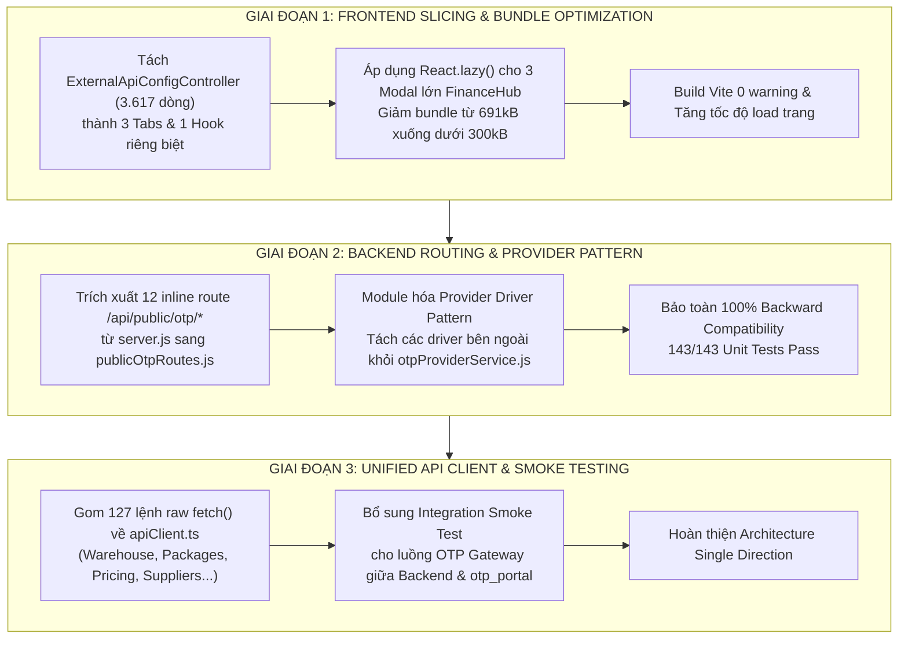

# KẾ HOẠCH TỔNG THỂ REFACTOR HỆ THỐNG (SYSTEM REFACTORING MASTER PLAN)

> **Dự án:** `admin_orderlist` & `otp_portal`  
> **Ngày lập:** 09/11/2026  
> **Chủ trì thẩm định:** 👑 Master (Sếp)  
> **Tổng chỉ huy kỹ thuật:** 👑 Orchestrator Agent & Lead Planner  
> **Trạng thái:** 📋 Chờ Master phê duyệt từng giai đoạn (Pending Approval)  
> **Nguyên tắc cốt lõi:** Zero Downtime • Zero Breaking Changes • 100% Backward Compatible • 143/143 Tests Pass.

---

## 🧭 I. BỐI CẢNH & MỤC TIÊU CHIẾN LƯỢC

Sau quá trình rà soát dữ liệu thực tế trên 689 tệp tin của toàn bộ hệ thống, dự án đã đạt trạng thái ổn định vững chắc:
- ✅ **143/143 Backend Unit Tests PASS 100%**.
- ✅ **0 lỗi TypeScript compile**, build production thành công.
- ✅ **100% tệp tin sạch mã hóa UTF-8 No-BOM**, sạch hoàn toàn lỗi Mojibake và dấu chấm hỏi `?`.

Tuy nhiên, mã nguồn vẫn tồn đọng các "khối nợ kỹ thuật" (Architectural Hotspots) phát sinh qua quá trình phát triển nhanh tính năng:
1. **Frontend Monolith**: Tệp tin [`ExternalApiConfigController.tsx`](file:///d:/Desktop/admin/admin_orderlist/frontend/src/features/external-api/components/ExternalApiConfigController.tsx) dài **3.617 dòng**, là tệp lớn nhất toàn dự án, dồn nén toàn bộ logic UI, state, modal và test runner vào chung một nơi.
2. **Bundle Size Warning**: Trang [`FinanceHubPage.tsx`](file:///d:/Desktop/admin/admin_orderlist/frontend/src/features/finance/FinanceHubPage.tsx) sinh chunk **691.72 kB** (vượt ngưỡng 500 kB của Vite) do các modal nặng (`CreateReceiptModal` 1.062 dòng, `PersonalAssetsModal` 919 dòng, `AllocateReceiptModal` 816 dòng) đang được import tĩnh.
3. **Phân mảnh Transport Layer**: Có tới **39 tệp tin frontend** đang gọi trực tiếp hàm `fetch()` (tổng cộng **127 lần gọi raw fetch** không qua `apiClient`), dẫn đến thiếu sót trong tự động hóa gửi credentials, xử lý lỗi 401 và bắt timeout tập trung.
4. **Backend Router & Provider Hotspot**: Tệp khởi động [`server.js`](file:///d:/Desktop/admin/admin_orderlist/backend/src/server.js) đang ôm 12 route `/api/public/otp/*` viết inline dài 150 dòng; tệp [`otpProviderService.js`](file:///d:/Desktop/admin/admin_orderlist/backend/src/domains/system/services/otpProviderService.js) (971 dòng) gom chung toàn bộ driver gọi ngoài của các bên thứ 3 (HDSD, TinyHost, Ades, Yuna, VivaRocky).

---

## 🗺️ II. LỘ TRÌNH TRIỂN KHAI 3 GIAI ĐOẠN (3-PHASE ROADMAP)



---

## 📌 CHI TIẾT TỪNG GIAI ĐOẠN (DETAILED SPECIFICATIONS)

### 🚀 GIAI ĐOẠN 1: Phân Rã `ExternalApiConfigController` (3.617 dòng) & Tối Ưu Bundle `FinanceHub`

- **Mục tiêu**:
  - Đưa tệp tin lớn nhất dự án [`ExternalApiConfigController.tsx`](file:///d:/Desktop/admin/admin_orderlist/frontend/src/features/external-api/components/ExternalApiConfigController.tsx) từ 3.617 dòng về mức chuẩn sạch (~350 dòng).
  - Triệt tiêu hoàn toàn cảnh báo vàng của Vite Build đối với `FinanceHubPage` (từ 691 kB xuống < 300 kB).

- **Bóc tách cấu trúc mới cho `features/external-api/`**:
  ```
  frontend/src/features/external-api/
  ├── components/
  │   ├── ExternalApiConfigController.tsx     # (Router/Container chính điều phối tabs, ~350 dòng)
  │   ├── OtpPortalSlotsTab.tsx               # (Quản lý & test nhanh 7 ô input Web OTP Portal)
  │   ├── ApiCrudManagerTab.tsx               # (Quản lý danh sách cổng API bên thứ 3)
  │   ├── ProductApiMappingTab.tsx            # (Bảng liên kết sản phẩm catalog với cổng API)
  │   ├── ApiCreateEditModal.tsx              # (Modal tạo/sửa cấu hình cổng API)
  │   └── DynamicJsonModal.tsx                # (Modal xem/sửa cấu hình JSON linh hoạt)
  └── hooks/
      └── useExternalApiConfig.ts             # (Quản lý toàn bộ State, Fetch, Mutate, Test runner)
  ```

- **Tối ưu hóa Bundle `FinanceHubPage`**:
  - Chuyển 3 modal lớn sang `React.lazy()`:
    ```tsx
    const CreateReceiptModal = React.lazy(() => import('../invoices/components/CreateReceiptModal'));
    const AllocateReceiptModal = React.lazy(() => import('../invoices/components/AllocateReceiptModal'));
    const PersonalAssetsModal = React.lazy(() => import('./components/PersonalAssetsModal'));
    ```
  - Bọc quanh modal bằng `<Suspense fallback={null}>`. Khi người dùng không mở modal, trình duyệt hoàn toàn không cần nạp 2.800 dòng code của 3 modal này.

- **Tiêu chí nghiệm thu (Acceptance Criteria)**:
  ```gherkin
  Scenario: Phân rã ExternalApiConfigController và tối ưu bundle FinanceHub
    Given Mã nguồn frontend sau khi phân rã các tab và lazy-load modal
    When Chạy lệnh npm run build trong thư mục frontend
    Then 100% build thành công, 0 lỗi TypeScript
    And Không còn bất kỳ cảnh báo chunk nào vượt ngưỡng 500 kB
    And Toàn bộ thao tác cấu hình cổng API và test 7 ô input OTP hoạt động chính xác như cũ
  ```

---

### 🚀 GIAI ĐOẠN 2: Làm Sạch `server.js` & Chuẩn Hóa Provider Driver Pattern Cho OTP

- **Mục tiêu**:
  - Trả lại vai trò mỏng nhẹ cho [`server.js`](file:///d:/Desktop/admin/admin_orderlist/backend/src/server.js) (chỉ bootstrap và mount middleware).
  - Tách [`otpProviderService.js`](file:///d:/Desktop/admin/admin_orderlist/backend/src/domains/system/services/otpProviderService.js) (971 dòng) thành mô hình Driver độc lập theo chuẩn Provider Pattern.

- **Bóc tách Router**:
  - Tạo mới: [`backend/src/domains/system/routes/publicOtpRoutes.js`](file:///d:/Desktop/admin/admin_orderlist/backend/src/domains/system/routes/publicOtpRoutes.js)
  - Di chuyển 12 endpoint `/api/public/otp/*` (`adobe/code`, `adobe/account`, `netflix/household`, `netflix/six-digit`, `netflix/login-otp`, `gpt/account`, `gpt/code`, `2fa/generate`, `probe-slot`, `activate-key`...) vào router này.
  - Trong `server.js`: Chỉ cần 1 dòng khai báo sạch sẽ:
    ```javascript
    app.use("/api/public/otp", require("@/domains/system/routes/publicOtpRoutes"));
    ```

- **Bóc tách Provider Drivers**:
  - Tạo thư mục: `backend/src/domains/system/providers/`
    - `hdsdProvider.js`: Driver kết nối `otp.hdsd.net`.
    - `tinyhostProvider.js`: Driver kết nối `tinyhost.shop`.
    - `adesProvider.js`: Driver kết nối `ades.support` và cache token session.
    - `yunaProvider.js`: Driver kết nối `hub.yunagrp.com` và `mail.yunagrp.com`.
    - `vivarockyProvider.js`: Driver kết nối VivaRocky (Household, 6-digit, signin code).
    - `warehouse2faProvider.js`: Driver tra cứu mã 2FA nội bộ từ kho hàng.
  - `otpProviderService.js`: Đóng vai trò Facade mỏng nhẹ điều phối (`probeOtpForEmail`, `executeOtpConfig`), nạp các driver động qua registry.

- **Tiêu chí nghiệm thu (Acceptance Criteria)**:
  ```gherkin
  Scenario: Chuyển đổi sang Provider Driver Pattern và làm sạch server.js
    Given Các provider driver đã được tách riêng vào thư mục providers/
    When Chạy toàn bộ test suite với npm --prefix backend test
    Then 143/143 unit tests PASS 100%
    And Mọi cuộc gọi API public từ web otp_portal trả về đúng dữ liệu, đúng mã OTP
    And server.js giảm từ 360 dòng xuống còn dưới 200 dòng
  ```

---

### 🚀 GIAI ĐOẠN 3: Chuẩn Hóa Unified API Client Frontend & Bổ Sung E2E Tests

- **Mục tiêu**:
  - Xóa bỏ triệt để 127 lệnh gọi `fetch()` rời rạc trong 39 tệp tin frontend, đưa về dùng chung qua [`apiClient.ts`](file:///d:/Desktop/admin/admin_orderlist/frontend/src/shared/api/apiClient.ts) hoặc các feature API client tương ứng.
  - Xây dựng bài kiểm thử tích hợp (Integration Smoke Test) giữa luồng OTP Backend và giao diện Web OTP Portal.

- **Danh sách các trang chuyển đổi ưu tiên**:
  1. [`WarehousePage.tsx`](file:///d:/Desktop/admin/admin_orderlist/frontend/src/pages/WarehousePage.tsx): 12 lệnh `fetch` $\rightarrow$ Chuyển sang `warehouseApiClient.ts`.
  2. [`PackageManagementPage.tsx`](file:///d:/Desktop/admin/admin_orderlist/frontend/src/features/packages/PackageManagementPage.tsx): 10 lệnh `fetch` $\rightarrow$ Chuyển sang `packagesApiClient.ts`.
  3. [`PricingPage.tsx`](file:///d:/Desktop/admin/admin_orderlist/frontend/src/pages/PricingPage.tsx): 10 lệnh `fetch` $\rightarrow$ Chuyển sang `pricingApiClient.ts`.
  4. [`PaymentWalletsPage.tsx`](file:///d:/Desktop/admin/admin_orderlist/frontend/src/pages/PaymentWalletsPage.tsx): 9 lệnh `fetch` $\rightarrow$ Chuyển sang `walletsApiClient.ts`.
  5. [`SuppliersPage.tsx`](file:///d:/Desktop/admin/admin_orderlist/frontend/src/pages/SuppliersPage.tsx): 8 lệnh `fetch` $\rightarrow$ Chuyển sang `suppliersApiClient.ts`.

- **Tiêu chí nghiệm thu (Acceptance Criteria)**:
  ```gherkin
  Scenario: Thống nhất API Client toàn diện ở Frontend
    Given 39 tệp tin frontend được chuẩn hóa gọi API qua apiClient
    When Người dùng thao tác trên các trang Kho Hàng, Bảng Giá, Nhà Cung Cấp, Ví Thanh Toán
    Then Mọi request đều tự động mang header xác thực chuẩn, tự động bắt 401 khi hết hạn phiên
    And Quét lại codebase ghi nhận 0 lệnh fetch() thô không bảo vệ
  ```

---

## 🛑 III. NHỮNG ĐIỀU TUYỆT ĐỐI CẤM LÀM (SAFETY REDLINES)

1. **CẤM ĐỔI API CONTRACT**: Tuyệt đối không thay đổi endpoint path, query parameters, payload gửi đi hay cấu trúc JSON trả về của bất kỳ API nào (đặc biệt là các API public phục vụ cho `otp_portal` và các webhook bên thứ 3).
2. **CẤM MẤT MÁT TÍNH NĂNG (Zero Regression)**: Mọi chức năng sau refactor phải hoạt động tương đương 100% so với code cũ.
3. **CẤM COMMIT RÁC HOẶC TẠO FILE TRÙNG LẶP**: Tuyệt đối không tạo file dạng `v2`, `temp`, `backup`, `old` bên cạnh code gốc.
4. **CẤM PHÁ VỠ ACID DATABASE**: Mọi thao tác ghi dữ liệu nhiều bảng trong backend bắt buộc bọc trong Knex transaction theo chuẩn ACID.

---

## 📋 IV. QUY TRÌNH THỰC THI & NGHIỆM THU TỪNG BƯỚC

Mỗi giai đoạn khi được Master phê duyệt triển khai sẽ tuân thủ nghiêm ngặt quy trình:
1. Xuất gói đề xuất hợp nhất **Spec-Kit + Pre-Flight Check** trước khi chạm vào mã nguồn.
2. Triển khai theo từng slice nhỏ (ví dụ: bóc tách từng tab trong `ExternalApiConfigController`).
3. Chạy toàn bộ Verification Gates:
   - Backend: `npm --prefix backend test` (143/143 tests).
   - Frontend: `npm --prefix frontend run build` (0 lỗi TS).
   - Diff check: `git diff --check`.
4. Ghi nhận đề mục nghiệm thu vào [`report/YYYY-MM-DD-daily-review.md`](file:///d:/Desktop/admin/admin_orderlist/report/2026-11-09-daily-review.md) theo quy tắc Single Daily Report.

---

👉 **Trạng thái:** Kế hoạch đã được lưu trữ vĩnh viễn tại [`docs/plans/2026-11-09-comprehensive-system-refactoring-plan.md`](file:///d:/Desktop/admin/admin_orderlist/docs/plans/2026-11-09-comprehensive-system-refactoring-plan.md) để làm nguồn sự thật duy nhất (SSOT) cho toàn đội ngũ AI Subagents. Khi Master chỉ định giai đoạn bắt đầu, đội ngũ sẽ lập tức khởi động triển khai.

