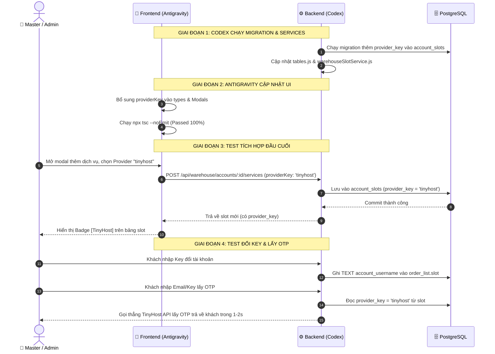

# KẾ HOẠCH CHI TIẾT: TỰ ĐỘNG HÓA CẤP TÀI KHOẢN & ĐIỀU PHỐI OTP (WORKFLOW PLAN)

> **Dự án:** `admin_orderlist`  
> **Chủ nhân tối cao (Sovereign):** 👑 **Master (Sếp)**  
> **Phân công thực thi song song:**  
> - 🎨 **Frontend Lead (Antigravity AI):** Phụ trách toàn bộ UI/UX, Component Modals, Type definitions, Form binding và hiển thị dữ liệu Kho Hàng.  
> - ⚙️ **Backend Specialist (Codex AI):** Phụ trách Database migration, Knex queries, Schema contracts, Warehouse slot service, Order key generation, Activation service và OTP direct dispatcher.  
> **Ngày lập:** 2026-11-16  
> **Trạng thái:** Sẵn sàng thực thi song song (Ready for Execution)

---

## 🏛️ I. NGUYÊN TẮC BẤT DI BẤT DỊCH (REDLINES - SINGLE SOURCE OF TRUTH)

Cả hai AI (Antigravity & Codex) bắt buộc phải tuân thủ nghiêm ngặt 3 nguyên tắc kỹ thuật tối cao sau:

1. 🛑 **REDLINE 1: CỘT `order_list.slot` BẮT BUỘC LƯU CHUỖI TEXT TÀI KHOẢN (`account_username`)**:
   - Khi cấp slot cho đơn hàng, giá trị ghi vào cột `order_list.slot` **PHẢI LÀ CHUỖI TEXT EMAIL / TÊN ĐĂNG NHẬP** (ví dụ: `hungle@gmail.com`).
   - **TUYỆT ĐỐI CẤM GHI ID SỐ** (như `slot_id` hoặc `account_id`).
   - *Lý do kỹ thuật:* Thuật toán Kho Gói Sản Phẩm ([packageProductService.js:83-86](file:///D:/Desktop/admin/admin_orderlist/backend/src/domains/products/services/packageProductService.js#L83-L86)) đang chạy thực tế dựa trên so khớp chuỗi: `CAST(slot AS TEXT) ILIKE ?` với `account_username`. Ghi ID số sẽ làm gãy hoàn toàn logic Kho Gói Sản Phẩm!

2. 🛑 **REDLINE 2: GẮN PROVIDER OTP VÀO DỊCH VỤ (`warehouse.account_slots`), KHÔNG GẮN VÀO TÀI KHOẢN MẸ**:
   - Bảng tài khoản kho `warehouse.accounts` là tài khoản mẹ.
   - Bảng `warehouse.account_slots` (`STOCK_SERVICES`) là các dịch vụ con bên trong tài khoản (Canva, Netflix, Spotify...).
   - **Provider OTP BẮT BUỘC phải lưu tại `warehouse.account_slots.provider_key`** để đảm bảo từng dịch vụ có thể trỏ về đúng nhà cung cấp giải mã OTP tương ứng (`tinyhost`, `ades`, `yuna_mail`...).

3. 🛑 **REDLINE 3: AN TOÀN DỮ LIỆU & TƯƠNG THÍCH NGƯỢC (BACKWARD COMPATIBILITY)**:
   - Cột `provider_key` trong `warehouse.account_slots` là `VARCHAR(100)` cho phép `NULL`.
   - Nếu slot chưa được gán `provider_key`, hệ thống tự động fallback về cơ chế routing cũ ([portal_slot_routing_rules](file:///D:/Desktop/admin/admin_orderlist/backend/src/domains/system/services/productApiService.js#L685)), tuyệt đối không gây lỗi gián đoạn hệ thống.

---

## 📦 II. HỢP ĐỒNG DỮ LIỆU CHUNG (SHARED DATA CONTRACTS)

### 1. Danh Mục Provider Khả Dụng (Provider Keys Catalog)
Danh sách các mã Provider chuẩn hóa đã sẵn sàng trong [backend/src/domains/system/providers/registry.js](file:///D:/Desktop/admin/admin_orderlist/backend/src/domains/system/providers/registry.js):

| `provider_key` | Tên Hiển Thị (Display Name) | Phân Loại (Category) | Mô Tả |
| :--- | :--- | :--- | :--- |
| `tinyhost` | TinyHost OTP | OTP | Cổng giải OTP tự động qua API TinyHost |
| `ades` | Ades OTP | OTP | Cổng giải OTP hệ thống Adobe / Ades |
| `fix_ades_status` | Fix Ades Status | Tool | Công cụ kiểm tra và chuyển team Ades |
| `yuna_mail` | Yuna Mail | OTP / Email | Đọc email và bóc tách OTP từ hòm thư Yuna |
| `yuna_2fa` | Yuna 2FA | 2FA | Tra cứu thông tin tài khoản và 2FA |
| `vivarocky_household` | VivaRocky Household | OTP | Giải link xác nhận hộ gia đình Netflix |
| `vivarocky_six_digit` | VivaRocky 6-Digit | OTP | Lấy mã OTP 6 số Netflix |
| `vivarocky_signin` | VivaRocky Sign-in | OTP | Lấy mã đăng nhập một lần Netflix |
| `totp` | TOTP Authenticator | 2FA | Tự động sinh mã 6 số từ chuỗi 2FA Secret |
| `warehouse_2fa` | Kho 2FA Nội Bộ | 2FA | Tra cứu secret 2FA lưu trực tiếp trong kho hàng |
| `imap` | Hòm Thư IMAP | Email OTP | Quét mã OTP trực tiếp từ server mail IMAP |

### 2. Cấu Trúc Database Cần Thêm (Schema Contract)
```sql
-- Migration: Add provider_key to warehouse.account_slots
ALTER TABLE warehouse.account_slots
  ADD COLUMN IF NOT EXISTS provider_key VARCHAR(100);

CREATE INDEX IF NOT EXISTS idx_warehouse_account_slots_provider_key
  ON warehouse.account_slots(provider_key);
```

### 3. Hợp Đồng API Frontend <-> Backend (API Contract)

#### A. Thêm dịch vụ vào tài khoản kho
* **Endpoint:** `POST /api/warehouse/accounts/:id/services`
* **Request Payload (JSON):**
  ```json
  {
    "serviceName": "Canva Pro",
    "category": "Canva",
    "variantTag": "1_YEAR",
    "password": "Password123@",
    "backupEmail": "backup@domain.com",
    "twoFa": "JBSWY3DPEHPK3PXP",
    "expiresAt": "2027-11-16",
    "status": "AVAILABLE",
    "note": "Hàng nhập đợt 1",
    "providerKey": "tinyhost"
  }
  ```

#### B. Chỉnh sửa slot dịch vụ
* **Endpoint:** `PUT /api/warehouse/slots/:id`
* **Request Payload (JSON):**
  ```json
  {
    "serviceName": "Canva Pro",
    "variantTag": "1_YEAR",
    "password": "NewPassword123@",
    "backupEmail": "backup@domain.com",
    "twoFa": "JBSWY3DPEHPK3PXP",
    "expiresAt": "2027-11-16",
    "status": "AVAILABLE",
    "note": "Cập nhật provider",
    "providerKey": "ades"
  }
  ```

#### C. Lấy danh sách tài khoản & slots
* **Endpoint:** `GET /api/warehouse/accounts`
* **Response Item Slot Object:**
  ```json
  {
    "id": 105,
    "display_name": "Canva Pro",
    "category": "Canva",
    "variant_tag": "1_YEAR",
    "status": "AVAILABLE",
    "provider_key": "tinyhost",
    "expires_at": "16/11/2027",
    "two_fa": "JBSWY3DPEHPK3PXP"
  }
  ```

---

## ⚙️ PHẦN 1: BACKEND SPECIFICATION (GIAO CHO CODEX)

### 📌 Trách nhiệm của Codex:
Codex phụ trách toàn bộ logic Database, Schema, Service Warehouse, Order Key Generation, Activation Service và OTP Direct Dispatching.

### 📝 Checklist Nhiệm Vụ Cho Codex:

#### Task B1: Migration & Schema Centralization
1. **Tạo Migration File**: `backend/src/db/migrations/20261116000001_add_provider_key_to_account_slots.js`.
   - Bổ sung cột `provider_key VARCHAR(100)` vào bảng `${schemaWarehouse}.account_slots`.
   - Tạo index `idx_warehouse_account_slots_provider_key`.
   - Viết hàm `down` rollback an toàn (`DROP COLUMN IF EXISTS provider_key`).
2. **Cập nhật Single Source of Truth**:
   - File [backend/src/db/tables.js](file:///D:/Desktop/admin/admin_orderlist/backend/src/db/tables.js): Thêm `PROVIDER_KEY: "provider_key"` vào `COLS.ACCOUNT_SLOTS`.

#### Task B2: Nâng cấp Warehouse Slot Service
1. **File:** [backend/src/domains/warehouse/services/warehouseSlotService.js](file:///D:/Desktop/admin/admin_orderlist/backend/src/domains/warehouse/services/warehouseSlotService.js)
   - Trong hàm `addServiceSlotToAccount(accountId, payload)`:
     - Trích xuất `providerKey` từ `payload` (`payload.providerKey` hoặc `payload.provider_key`).
     - Chuẩn hóa: `const cleanProviderKey = providerKey ? String(providerKey).trim() : null;`.
     - Thêm trường `[SS.PROVIDER_KEY]: cleanProviderKey` vào lệnh `insert` của `TABLES.STOCK_SERVICES`.
   - Trong hàm `updateWarehouseServiceSlot(slotId, payload)`:
     - Trích xuất `providerKey` nếu có trong `payload`.
     - Thêm `[SS.PROVIDER_KEY]: cleanProviderKey` vào `updateFields`.
2. **File:** [backend/src/domains/warehouse/services/warehouseService.js](file:///D:/Desktop/admin/admin_orderlist/backend/src/domains/warehouse/services/warehouseService.js)
   - Đảm bảo query lấy danh sách slots trả về trường `ss.provider_key as provider_key`.

#### Task B3: Chuẩn Hóa Cấp Tài Khoản & Gán Text Username Vào `order_list.slot`
1. **File:** [backend/src/domains/products/services/activationKeyService.js](file:///D:/Desktop/admin/admin_orderlist/backend/src/domains/products/services/activationKeyService.js)
   - Kiểm tra hàm `activateKeyWithTransaction`:
     - Khi tìm được `availableSlot`: Lấy `assignedAccount = availableSlot.account_username` (chuỗi TEXT email/username).
     - Ghi nhận: Cập nhật `order_list.slot = assignedAccount` (**BẮT BUỘC CHUỖI TEXT, KHÔNG GHI ID**).
     - Cập nhật slot trong `account_slots`: `status = 'IN_USE'`, `id_order = key.id_order`, `customer = finalCustomer`.
     - Trả về payload cho khách: `{ account: assignedAccount, password: slot.password || account.password, ... }`.

#### Task B4: Điều Phối OTP Trực Tiếp Từ Slot Provider (Direct Dispatching)
1. **File:** [backend/src/domains/system/services/productApiService.js](file:///D:/Desktop/admin/admin_orderlist/backend/src/domains/system/services/productApiService.js)
   - Trong hàm `findRoutingProviderForInput({ slotKey, input })`:
     - **Bước 4.1:** Kiểm tra xem `input` là Mã Key (từ `activation_keys`) hay Email/Username tài khoản:
       - Nếu là Mã Key: Tra cứu `activation_keys` lấy `account_slot_id` hoặc `assigned_account`.
     - **Bước 4.2:** Tra cứu slot trong `warehouse.account_slots`:
       - Query slot kèm `ss.provider_key as slot_provider_key`.
     - **Bước 4.3:** Nếu `slot.slot_provider_key` tồn tại và không rỗng:
       - **TRẢ VỀ NGAY LẬP TỨC**:
         ```javascript
         return {
           provider_key: slot.slot_provider_key,
           match_type: "DIRECT_SLOT_PROVIDER",
           source: "WAREHOUSE_SLOT",
         };
         ```
     - **Bước 4.4:** Nếu không có `slot_provider_key`, tiếp tục fallback về logic `portal_slot_routing_rules` như hiện tại.

#### Task B5: Kiểm Tra & Chạy Test Backend
- Chạy thử migration với lệnh sandboxed.
- Kiểm tra query Knex không bị lỗi cú pháp cột.

---

## 🎨 PHẦN 2: FRONTEND SPECIFICATION (GIAO CHO ANTIGRAVITY)

### 📌 Trách nhiệm của Antigravity:
Antigravity phụ trách toàn bộ giao diện quản trị Kho Hàng, định nghĩa TypeScript interfaces, dropdown chọn Provider khi thêm/sửa dịch vụ, và hiển thị Badge Provider trên bảng slot.

### 📝 Checklist Nhiệm Vụ Cho Antigravity:

#### Task F1: Cập Nhật Typescript Data Contracts
1. **File:** [frontend/src/features/warehouse/types.ts](file:///D:/Desktop/admin/admin_orderlist/frontend/src/features/warehouse/types.ts)
   - Cập nhật `WarehouseServiceSlot`:
     ```typescript
     export interface WarehouseServiceSlot {
       id: number;
       display_name: string;
       category: string;
       variant_tag?: string;
       login_url?: string;
       password?: string;
       backup_email?: string;
       two_fa?: string;
       otp_type?: string;
       provider_key?: string | null; // <-- THÊM MỚI
       expires_at?: string;
       raw_expires_at?: string;
       note?: string;
       is_authenticated?: boolean;
       session_checked_at?: string | null;
       status: WarehouseSlotStatus;
     }
     ```
   - Cập nhật `WarehouseAddServiceFormData`:
     ```typescript
     export interface WarehouseAddServiceFormData {
       serviceName: string;
       category: string;
       variantTag: string;
       password: string;
       backupEmail: string;
       twoFa: string;
       expiresAt: string;
       status: WarehouseSlotStatus;
       note: string;
       providerKey?: string; // <-- THÊM MỚI
     }
     ```
   - Cập nhật `WarehouseSlotEditFormData`:
     ```typescript
     export interface WarehouseSlotEditFormData {
       accountUsername: string;
       serviceName: string;
       variantTag: string;
       password: string;
       backupEmail: string;
       twoFa: string;
       otpType?: string;
       providerKey?: string; // <-- THÊM MỚI
       expiresAt: string;
       status: WarehouseSlotStatus;
       note: string;
     }
     ```

#### Task F2: Tạo Danh Mục Lựa Chọn Provider Hằng Số Cho UI
1. Tạo hằng số `AVAILABLE_OTP_PROVIDERS` dùng chung cho các Modal:
   ```typescript
   export const AVAILABLE_OTP_PROVIDERS = [
     { value: "", label: "-- Không chọn (Mặc định) --" },
     { value: "tinyhost", label: "TinyHost OTP (tinyhost)" },
     { value: "ades", label: "Ades OTP (ades)" },
     { value: "yuna_mail", label: "Yuna Mail (yuna_mail)" },
     { value: "yuna_2fa", label: "Yuna 2FA (yuna_2fa)" },
     { value: "vivarocky_household", label: "VivaRocky Household (Netflix)" },
     { value: "vivarocky_six_digit", label: "VivaRocky 6-Digit (Netflix)" },
     { value: "vivarocky_signin", label: "VivaRocky Sign-in (Netflix)" },
     { value: "totp", label: "TOTP Tự Sinh (2FA Secret)" },
     { value: "warehouse_2fa", label: "Kho 2FA Nội Bộ (warehouse_2fa)" },
     { value: "imap", label: "Hòm Thư IMAP (imap)" },
   ];
   ```

#### Task F3: Nâng Cấp Form "Thêm Dịch Vụ" ([WarehouseAddServiceModal.tsx](file:///D:/Desktop/admin/admin_orderlist/frontend/src/features/warehouse/components/WarehouseAddServiceModal.tsx))
- Thêm state `providerKey` (mặc định rỗng `""`).
- Thêm trường input dạng `<select>` hoặc Dropdown UI chọn Provider OTP đặt ngay cạnh ô 2FA / Email dự phòng.
- Khi bấm "Thêm Dịch Vụ", gửi `providerKey` trong object gửi lên hàm `onSubmit(formData)`.

#### Task F4: Nâng Cấp Form "Sửa Dịch Vụ" ([WarehouseEditSlotModal.tsx](file:///D:/Desktop/admin/admin_orderlist/frontend/src/features/warehouse/components/WarehouseEditSlotModal.tsx))
- Nhận `slot.provider_key` vào state khởi tạo của modal.
- Bổ sung trường chọn Provider OTP để Admin có thể đổi Provider bất cứ lúc nào nếu NCC đổi cách cấp OTP.
- Gửi `providerKey` khi gọi API cập nhật slot.

#### Task F5: Hiển Thị Badge Provider Trên Bảng Slot ([WarehouseSlotSubTable.tsx](file:///D:/Desktop/admin/admin_orderlist/frontend/src/features/warehouse/components/WarehouseSlotSubTable.tsx))
- Trên từng dòng slot, hiển thị thêm Badge Provider nhỏ gọn (màu tím/xanh ngọc) bên cạnh thông tin dịch vụ (ví dụ: `[TinyHost]`, `[Ades]`, `[Yuna]`).
- Giúp người vận hành nhìn lướt qua là biết ngay dịch vụ này đang dùng cổng OTP nào.

#### Task F6: Kiểm Tra TypeCheck Frontend
- Chạy `npx tsc --noEmit` để đảm bảo 0 lỗi biên dịch TypeScript.

---

## 🤝 III. QUY TRÌNH PHỐI HỢP SONG SONG & NGHIỆM THU TÍCH HỢP



---

## 🎯 IV. TIÊU CHUẨN HOÀN THÀNH (DEFINITION OF DONE)

1. Cột `provider_key` đã hiện diện an toàn trong `warehouse.account_slots`.
2. Admin có thể chọn và sửa Provider OTP mượt mà trên giao diện Kho Hàng.
3. Bảng hiển thị rõ Badge Provider trên từng slot.
4. `order_list.slot` lưu đúng TEXT username, Kho Gói Sản Phẩm khớp slot 100%.
5. OTP Portal nhận diện chính xác Provider trực tiếp từ slot dịch vụ.
6. TypeScript `npx tsc --noEmit` đạt mã 0 (không phát sinh lỗi).
7. Báo cáo nghiệm thu hoàn tất được ghi vào `report/2026-11-16-daily-review.md`.
