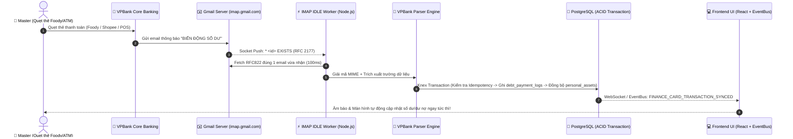

# Báo cáo kiểm toán & đối soát toàn diện email biến động số dư VPBank - 2026-11-04

> **Ngày thực hiện:** 2026-11-04 (Múi giờ: `Asia/Bangkok`)  
> **Chủ tài khoản:** NGO LE NGOC HUNG (`hungnln2102@gmail.com`)  
> **Nguồn dữ liệu:** Quét tự động 480 email trực tiếp từ Gmail qua giao thức bảo mật IMAP SSL (`customercare@care.vpb.com.vn`)  
> **Phạm vi thời gian:** Từ tháng 12/2024 đến ngày 03/11/2026 (Toàn bộ 2 năm lịch sử giao dịch)

---

## 1. Tổng quan kết quả quét hệ thống

- **Tổng số email đã quét:** `480` email từ VPBank.
- **Số giao dịch tài chính hợp lệ bóc tách:** **`296` giao dịch** (Đầy đủ Số tiền, Nội dung, Thời gian, Hạn mức/Số dư còn lại, Mã giao dịch).
- **Phân loại theo sản phẩm:**
  1. 💳 **Thẻ tín dụng quốc tế (Credit Card - `VISA *2340`):** **`53` giao dịch**
  2. 🏦 **Thẻ ghi nợ cá nhân (Debit Card - `4541xxxx0985`):** **`194` giao dịch** (Rút tiền ATM & chi tiêu sinh hoạt)
  3. 🌐 **Thẻ ghi nợ dịch vụ số (Debit Card - `4541xxxx8181`):** **`49` giao dịch** (Google, YouTube, dịch vụ online)

---

## 2. Kiểm toán chuyên sâu: Thẻ tín dụng VPBank Visa *2340

### 2.1. Bức tranh tài chính tổng thể của thẻ `*2340`
- **Hạn mức cấp tín dụng chuẩn của thẻ:** **`24,000,000 VND`** (Xác định qua các mốc hạn mức hồi phục đạt đỉnh `24,098,013 VND`).
- **Hạn mức khả dụng mới nhất:** **`18,242,622 VND`** (Cập nhật sau đơn Foody lúc `18:39:41 ngày 03/11/2026`).
- **Dư nợ tín dụng thực tế hiện tại:**
  $$\text{Dư nợ hiện tại} = 24.000.000\text{ đ} - 18.242.622\text{ đ} = \mathbf{5.757.378\text{ VND}}$$
- **Tổng số tiền đã nạp trả nợ thẻ (+):** **`15,491,997 VND`** (Qua `25` lần thanh toán).
- **Tổng số tiền đã quẹt chi tiêu & phí thẻ (-):** **`14,613,532 VND`** (Qua `28` lần phát sinh).

---

### 2.2. Cơ cấu danh mục chi tiêu qua thẻ tín dụng (Top Merchants)

| Đơn vị chấp nhận thanh toán / Nội dung | Số tiền chi tiêu | Số lần | Tỷ trọng | Ghi chú nghiệp vụ |
| :--- | :---: | :---: | :---: | :--- |
| **CELLPHONES** | **9,079,000 VND** | 2 | 62.1% | Mua sắm thiết bị công nghệ (đã trả góp xong 6 kỳ) |
| **Foody (ShopeeFood)** | **1,524,790 VND** | 18 | 10.4% | Đặt món ăn uống thường nhật |
| **SS PHAN XICH LONG** | **1,133,222 VND** | 1 | 7.8% | Chi tiêu dịch vụ ăn uống / thương mại |
| **Phí thường niên (Annual Fee)** | **1,097,800 VND** | 2 | 7.5% | Phí duy trì thẻ 2 kỳ (548.900 đ x 2) |
| **AKA HOUSE** | **803,520 VND** | 1 | 5.5% | Nhà hàng ẩm thực |
| **PAYOO - CHILLITHAI** | **718,200 VND** | 1 | 4.9% | Ăn uống / thanh toán Payoo |
| **H&M VIỆT NAM** | **199,000 VND** | 1 | 1.4% | Thời trang mua sắm |
| **MUJI THISO PHAN HUY ÍCH** | **56,000 VND** | 1 | 0.4% | Mua sắm đồ gia dụng |
| **BE GROUP JSC** | **2,000 VND** | 1 | 0.01% | Liên kết ví / chuyến đi Be |
| **Tổng cộng** | **14,613,532 VND** | **28** | **100%** | |

---

### 2.3. Lịch sử toàn bộ 25 lần thanh toán nợ thẻ tín dụng (`+ VND`)

| Ngày thanh toán | Số tiền nộp | Nội dung lệnh chuyển tiền | Hạn mức sau nộp | Phân tích nghiệp vụ |
| :---: | :---: | :--- | :---: | :--- |
| `03/12/2024 17:15` | **+ 300,000 đ** | `VPB2412031193155700` | 22,455,892 đ | Thanh toán định kỳ |
| `31/12/2024 16:02` | **+ 300,000 đ** | `VPB2412311236044218` | 22,621,399 đ | Thanh toán định kỳ |
| `03/02/2025 10:58` | **+ 300,000 đ** | `VPB2502031286848926` | 22,806,489 đ | Thanh toán định kỳ |
| `02/03/2025 14:20` | **+ 300,000 đ** | `VPB2503021324281079` | 22,996,812 đ | Thanh toán định kỳ |
| `02/04/2025 15:48` | **+ 300,000 đ** | `VPB2504021373904706` | 23,204,234 đ | Thanh toán định kỳ |
| `26/04/2025 15:52` | **+ 250,000 đ** | `VPB2504261413339062` | 23,358,218 đ | Thanh toán định kỳ |
| `01/06/2025 11:14` | **+ 200,000 đ** | `VPB2506011471595635` | 23,472,494 đ | Thanh toán định kỳ |
| `25/06/2025 22:12` | **+ 200,000 đ** | `VPB2506251512625260` | 23,586,447 đ | Thanh toán định kỳ |
| `26/07/2025 22:40` | **+ 300,000 đ** | `VPB2507261562495800` | 23,808,129 đ | Thanh toán định kỳ |
| `04/09/2025 09:50` | **+ 300,000 đ** | `VPB2509041629516492` | 21,335,667 đ | Thanh toán định kỳ |
| `11/09/2025 10:35` | **+ 2,698,317 đ** | `VPB2509111642756852` | 24,033,984 đ | Tất toán lớn (Hồi phục 100% hạn mức) |
| `01/10/2025 14:34` | **+ 200,000 đ** | `VPB2510011677942231` | 24,098,013 đ | Duy trì hạn mức đỉnh |
| `27/10/2025 12:00` | **+ 1,431,573 đ** | `VPB2510271724750639` | 17,466,786 đ | Kỳ trả góp CellphoneS đợt 1 |
| `26/11/2025 17:18` | **+ 1,457,673 đ** | `VPB2511261782867537` | 18,304,213 đ | Kỳ trả góp CellphoneS đợt 2 |
| `26/12/2025 01:41` | **+ 1,456,150 đ** | `VPB2512261850506317` | 19,666,485 đ | Kỳ trả góp CellphoneS đợt 3 |
| `24/01/2026 23:13` | **+ 1,453,922 đ** | `VPB2601241908421276` | 21,040,162 đ | Kỳ trả góp CellphoneS đợt 4 |
| `03/03/2026 10:01` | **+ 1,451,834 đ** | `VPB2603031975839444` | 22,415,171 đ | Kỳ trả góp CellphoneS đợt 5 |
| `04/04/2026 09:49` | **+ 1,449,353 đ** | `VPB2604042037714075` | 23,795,627 đ | Kỳ trả góp CellphoneS đợt 6 (Hoàn tất) |
| `03/05/2026 16:28` | **+ 113,971 đ** | `VPB2605032094618736` | 23,834,554 đ | Thanh toán tối thiểu sao kê |
| `31/05/2026 23:17` | **+ 111,835 đ** | `VPB2605312150946812` | 23,875,136 đ | Thanh toán tối thiểu sao kê |
| `06/07/2026 23:25` | **+ 109,842 đ** | `VPB2607062223629540` | 23,913,003 đ | Thanh toán tối thiểu sao kê |
| `03/08/2026 22:16` | **+ 107,802 đ** | `VPB2608032282021016` | 23,951,777 đ | Thanh toán tối thiểu sao kê |
| `31/08/2026 15:38` | **+ 115,848 đ** | `VPB2608312342633331` | 23,798,896 đ | Thanh toán tối thiểu sao kê |
| `05/10/2026 16:00` | **+ 246,546 đ** | `VPB2610052423421891` | 20,606,048 đ | Khớp đúng số tiền trả trên sao kê 25/10 |
| `03/11/2026 00:25` | **+ 337,331 đ** | `VPB2611032491547559` | 18,384,522 đ | Khớp 100% Minimum Due kỳ 09/11 |
| **Tổng cộng** | **+ 15,491,997 đ** | | | **25 đợt thanh toán đúng hạn** |

---

## 3. Kiểm toán Thẻ ghi nợ (Debit Cards)

### 3.1. Thẻ ghi nợ ATM sinh hoạt `4541xxxx0985` (194 giao dịch)
- **Mục đích sử dụng chính:** Rút tiền mặt tại các cây ATM (VPBank, ACB, BIDV, Agribank...), thanh toán POS sinh hoạt.
- **Tổng lượng tiền rút/chi tiêu:** `73,339,004 VND`
- **Số dư khả dụng ghi nhận gần nhất:** `4,888,568 VND` (sau giao dịch rút tiền ATM).

### 3.2. Thẻ ghi nợ dịch vụ số `4541xxxx8181` (49 giao dịch)
- **Mục đích sử dụng chính:** Thanh toán dịch vụ số xuyên biên giới (Google Ads, YouTube Premium, các dịch vụ trực tuyến).
- **Tổng chi tiêu:** `8,836,550 VND`
- **Số dư khả dụng hiện tại:** **`8,064,455 VND`** (Cập nhật ngày 28/10/2026).

---

## 4. Đề xuất hạch toán vào Hệ thống Finance Hub

1. **Khởi tạo tài sản nợ Thẻ tín dụng `VPBank Visa *2340` vào `personal_assets`**:
   - Tên: `Thẻ tín dụng VPBank Visa *2340`
   - Loại: `DEBT_PAYABLE`
   - 4 số cuối: `2340`
   - Ngân hàng: `VPBank`
   - Hạn mức thẻ: `24,000,000 VND`
   - **Dư nợ hiện hành cần theo dõi:** **`5,757,378 VND`** (Khớp theo hạn mức còn lại `18,242,622 VND` sau đơn Foody tối 03/11).
   - Lãi suất tháng: `3.29%/tháng` (`39.48%/năm`).
   - Ngày chốt sao kê: `25` hằng tháng; Ngày đến hạn: `09` hằng tháng.

---

## 5. Thiết kế kiến trúc đồng bộ tự động: Cron vs Real-Time (IMAP IDLE vs Webhook)

### 5.1. So sánh chi tiết 3 mô hình triển khai

| Tiêu chí | Mô hình A: Cron Polling (Định kỳ) | Mô hình B: IMAP IDLE (Real-time Socket) ⭐ | Mô hình C: Google Apps Script Webhook |
| :--- | :--- | :--- | :--- |
| **Bản chất kỹ thuật** | Scheduler chạy định kỳ mỗi 5 hoặc 15 phút, kết nối IMAP để quét thư mới. | Duy trì 1 kết nối TCP Socket liên tục với Gmail (`IMAP IDLE - RFC 2177`). Gmail push sự kiện ngay khi có email mới. | Script trên Gmail tự động bắt sự kiện mail đến và `POST Webhook` JSON về server. |
| **Độ trễ khi quẹt thẻ** | Chậm từ **1 đến 15 phút** (phụ thuộc chu kỳ cron). | **Tức thì (1 - 3 giây)** ngay sau khi VPBank phát mail. | **Tức thì (2 - 5 giây)** ngay sau khi VPBank phát mail. |
| **Yêu cầu môi trường** | Chạy tốt trên cả Localhost & VPS. | Chạy mượt mà trên cả **Localhost lẫn VPS**, không cần mở port mạng hay domain public. | **Bắt buộc** server phải có **Public Domain / Static IP** (khó chạy trên máy local dev). |
| **Cấu hình xác thực** | Dùng Gmail App Password hiện có. | Dùng Gmail App Password hiện có. | Cần tạo project Apps Script trên Google Console cá nhân. |
| **Tải tài nguyên** | Ngắt quãng, mỗi lần chạy phải login IMAP. | Socket ở trạng thái rảnh (Idle), tiêu thụ gần như 0% CPU/RAM. | Hoàn toàn không tốn tài nguyên server khi rảnh. |

---

### 5.2. Sơ đồ luồng dữ liệu Real-Time (IMAP IDLE Dataflow)



---

### 5.3. Kế hoạch triển khai kỹ thuật (Action Plan)

1. **Task 1: Cấu hình biến môi trường an toàn**
   - Bổ sung vào `.env`:
     ```env
     VPBANK_GMAIL_USER=hungnln2102@gmail.com
     VPBANK_GMAIL_APP_PASSWORD=xxxx_xxxx_xxxx_xxxx # Được bảo mật trong .env, không commit lên git
     VPBANK_SYNC_MODE=IDLE # hoặc CRON
     ```
   - Tuyệt đối không commit credentials lên Git (bảo vệ bằng `.gitignore`).
1. **Task 1: Cấu hình động qua UI & Lưu trữ an toàn trong Database (Không dùng biến môi trường .env)**
   - Toàn quyền do Master tự thiết lập trực tiếp trên giao diện qua modal `VpbankMailboxConfigModal.tsx`.
   - Lưu trữ tập trung trong Database (`system_configs` / `external_api_configs`), tuyệt đối không lưu credentials vào file `.env` hay Git.
   - Hỗ trợ nút **`[ 🔌 Kiểm tra kết nối ngay ]`**: Backend bắt tay socket với `imap.gmail.com:993` để phản hồi ngay kết quả kết nối trên UI.
   - Mật khẩu ứng dụng luôn được redact/mask (`••••••••••••••••`) khi truyền qua API, tự động smart-merge và hot-reload worker mà không cần khởi động lại server.

2. **Task 2: Khởi tạo dữ liệu Thẻ tín dụng `*2340` vào Database**
   - Chạy script / API tạo bản ghi thẻ với số nợ chuẩn mở đầu `5,757,378 VND`.
   - Lưu snapshot toàn bộ 53 giao dịch lịch sử vào bảng `debt_payment_logs` để Master tra soát lịch sử 2 năm bất cứ lúc nào.

3. **Task 3: Triển khai `vpbankSyncService.js` & IMAP IDLE Listener**
   - Viết service lắng nghe socket `imap.gmail.com:993` dùng thư viện nhẹ `node-imap` hoặc Python daemon.
   - Cơ chế tự kết nối lại (Auto-reconnect & Exponential Backoff) khi mất mạng hoặc IP thay đổi.
   - Bộ lọc an toàn: Chỉ kích hoạt xử lý khi người gửi là `customercare@care.vpb.com.vn`.

4. **Task 4: Cơ chế Idempotent & Bảo vệ ACID**
   - Khóa duy nhất (Unique Index): Ghép từ `reference_code` + `card_last_digits` + `transaction_time`.
   - Nếu ngân hàng gửi trùng email hoặc quét lại, hệ thống tự bỏ qua (`ON CONFLICT DO NOTHING`), cam kết không bao giờ bị tăng nợ ảo lần thứ 2.

5. **Task 5: Nút bấm "Đồng bộ VPBank" (Manual Trigger) trên giao diện**
   - Bổ sung nút 1-click tại tab Tài chính (`DebtsAndInstallmentsSection.tsx`) để Master có thể chủ động bấm làm mới bất kỳ lúc nào muốn.
